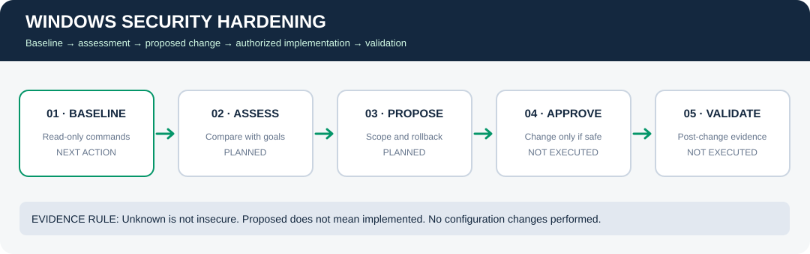

#  Cybersecurity

  

[← Portfolio](../README.md) · [Information security risk assessment](../Information-Security/Enterprise-Risk-Assessment/README.md)

My security work starts with the systems I support: Windows endpoints, identity controls, audit logs, and the changes that can improve visibility without disrupting operations.

## Completed assessments

| Project | What I investigated | Result |
|---|---|---|
| **[Windows Security Event Analysis](Windows-Security-Event-Analysis/README.md)** | 4624/4672 correlation, process auditing, log retention | **Real read-only investigation** · No confirmed incident |
| **[Windows Security Hardening](Windows-Security-Hardening/README.md)** | Firewall, Defender, auditing, PowerShell, BitLocker and boot posture | **Real 30-step assessment** · One approved log-size change |
| **[Enterprise Information Security Risk Assessment](../Information-Security/Enterprise-Risk-Assessment/README.md)** | Asset inventory, risk register, control mapping and treatment planning | **Simulated** · No real controls assessed |

## Windows security: two connected investigations

The first investigation established what the available events could tell us—and where limited retention and audit settings restricted visibility. The later hardening assessment checked the wider Windows security baseline and documented **CHG-001**, the approved increase of the Security log maximum from 20 MiB to 128 MiB.

## Areas I'm expanding

**SIEM and event monitoring**, **identity and access management**, and **incident response** are natural next steps. A Wazuh SIEM home lab and a dedicated IAM lab are planned; they are not presented as completed deployments.

## Working principles

I prefer small, verifiable changes, readable evidence, and explicit boundaries around what a test proves. A normal-looking event is not automatically safe; a high-privilege event is not automatically malicious. The context matters.

[← Back to the portfolio](../README.md)
