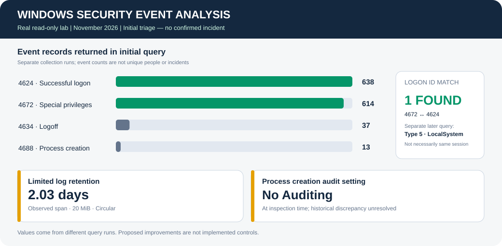

# Executive Summary — Windows Security Event Analysis

[Project overview](../README.md) · [Technical findings](event-analysis.md) · [Reproduction guide](lab-guide.md) · [Monitoring recommendations](monitoring-recommendations.md) · [Portfolio home](../../../README.md)

**Assessment type:** Real, read-only workstation log triage  
**Assessment status:** Initial assessment completed; no confirmed security incident  
**Evidence collection:** User-supplied, sanitized PowerShell console outputs from November 2026  
**Scope:** Local Windows Security event log only; no SIEM, network monitoring, endpoint-response investigation, or independent evidence export

## Executive conclusion

The investigation successfully demonstrated collection and interpretation of Windows Security logs and **correlation of a successful logon (4624) with a special-privileges-assigned event (4672) using their Logon IDs**. A separate bounded classification returned **Logon Type 5 (Service)** and the built-in **LocalSystem** account. These observations are **consistent with legitimate Windows service activity**; they do not establish privilege abuse or a compromise.

Two monitoring limitations merit follow-up: **a 20 MiB circular Security log holding a measured timestamp span of approximately 2.03 days**, and **Process Creation auditing disabled at policy-inspection time**. These are observations and visibility concerns, **not a demonstrated incident, breach, or compliance failure**.

## Findings at a glance

| Area | Verified observation | Assessment |
|---|---|---|
| Log availability | Security log enabled; 33,898 records at inspection | Available for local analysis |
| Retention | 20,971,520-byte (20 MiB) maximum; Circular; oldest 2026-11-15 20:02:39, newest 2026-11-17 20:40:43 | Approximately **2.03-day observed span**; seven-day lookback was not seven full days of evidence |
| Event inventory | 4624: 638; 4634: 37; 4672: 614; 4688: 13 | 1,302 **matching records**, not unique users, sessions, or incidents |
| Recent service logons | 100 of the 100 most recent 4624 events in one sample were Logon Type 5 | Sampling result only; not a population estimate |
| Built-in account | 5 of the 5 most recent 4624 events in another sample were Type 5 / LocalSystem | Consistent with routine service activity |
| Privileged logons | 3 recent 4672 records associated with LocalSystem, each listing the same 12 privileges | **Assignment, not confirmed privilege use** |
| Cross-event correlation | One bounded 4672-to-4624 Logon ID match; later independent query returned MatchFound=True, Type 5, LocalSystem | Session correlation verified; **not confirmed to be the same exact session in both runs** |
| Audit settings | Logon success/failure and special logon success enabled; process creation set to No Auditing | Process creation visibility gap |
| Policy-change search | No matching 4719 record returned from retained log | Does not rule out historic changes |

## Investigated question: why were event 4688 records present?

Five most recent retained 4688 records were timestamped **2026-11-16 14:30:43** with consecutive record IDs. The later audit-policy inspection indicated **Process Creation: No Auditing**. A search for event 4719 returned no matches.

**Disposition: unresolved.** A previous policy change is possible but **not established**. The investigation did not determine process names, audit policy at the time of those events, or a root cause. No claim of malicious process execution is justified.

## Recommendations (proposals, not implemented controls)

1. **Review log-retention requirements and capacity.** Define the desired investigation window and assess whether Security log size or centralized forwarding should be increased for that objective. Consider storage, privacy, and operational needs.
2. **Evaluate a controlled process-creation auditing pilot.** Review Audit Process Creation and the impact of additional events before enabling it, especially potential logging volume and sensitive command-line data.
3. **Document a triage baseline.** Treat frequent LocalSystem service logons and special privilege assignments in context, not as automatic incidents.
4. **Preserve investigation quality.** Use bounded PowerShell queries on resource-limited workstations; capture a reliable timestamp and sanitized evidence where approved.
5. **Revisit unresolved findings only with sufficient evidence.** Do not report an audit-policy change without a relevant historical record or other substantiation.

See [monitoring recommendations](monitoring-recommendations.md) for prioritization and verification criteria.

## Scope and evidence integrity

- Findings come from multiple console runs at **different moments**; counts and event samples are not necessarily directly comparable.
- A command requesting seven days does not guarantee seven days of data when the retained log spans only about two days.
- Queries used caps of 3, 5, or 100 records where appropriate, and results **must not** be generalized to all users or historical activity.
- No external log preservation, complete forensic chain of custody, test attack, remedial action, service attribution, incident classification, or SIEM analysis was performed.
- This is **real observation-based technical documentation**, not a simulated attack and not a completed security hardening deployment.

## References & Official Documentation

- [Microsoft Learn — Event 4624: Successful logon](https://learn.microsoft.com/en-us/windows/security/threat-protection/auditing/event-4624)
- [Microsoft Learn — Event 4672: Special privileges assigned to new logon](https://learn.microsoft.com/en-us/previous-versions/windows/it-pro/windows-10/security/threat-protection/auditing/event-4672)
- [Microsoft Learn — Audit Process Creation](https://learn.microsoft.com/en-us/windows/security/threat-protection/auditing/audit-process-creation)
- [Microsoft Learn — EventLogMode: Circular](https://learn.microsoft.com/en-us/dotnet/api/system.diagnostics.eventing.reader.eventlogmode)
- [Microsoft Learn — Windows Event Forwarding for intrusion detection](https://learn.microsoft.com/en-us/windows/security/operating-system-security/device-management/use-windows-event-forwarding-to-assist-in-intrusion-detection)

Official sources support the concepts and recommended methods; they do **not** independently certify results on the workstation.
