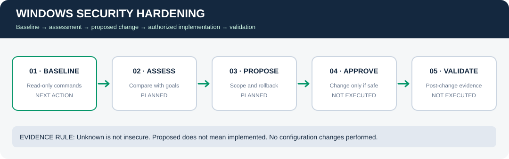

# Windows Security Hardening — Baseline, Improvement Plan & Validation

**Area:** Cybersecurity / Blue Team · Endpoint security  
**Evidence status:** **Read-only firewall, Microsoft Defender antivirus and advanced-protection settings verified.** Other controls remain pending; no configuration changes were made.  
**Environment:** Windows workstation, Windows PowerShell, built-in security controls. No new VM or commercial tools required.

[Portfolio home](../../README.md) · [Baseline guide](docs/baseline-guide.md) · [Assessment matrix](docs/security-assessment.md) · [Validation plan](docs/validation-plan.md) · [Related real event-analysis case](../Windows-Security-Event-Analysis/README.md)

## Why this project?

A prior **real Windows Security Event Analysis** investigation documented a locally enabled Security log with a 20 MiB circular maximum and an observed retained time span of approximately **2.03 days**. It also found the **Process Creation** audit subcategory set to **No Auditing** at inspection time. These findings motivate a broader security baseline review; they do **not** establish that other settings are insecure or that a security incident occurred.

This project separates **observation → assessment → proposed change → authorized implementation → post-change validation**. No changes will be applied without a deliberate review of compatibility, recovery steps and evidence.



## Scope

| Workstream | Initial read-only observation | Current evidence state |
|---|---|---|
| Windows Defender Antivirus | Service, antivirus, real-time, tamper and NIS protection reported `True`; signature age `0`; MAPS Advanced (`2`), safe sample submission (`1`) | **Selected health and advanced preferences verified; effectiveness and connectivity not tested** |
| Windows Firewall | Local query: three profiles enabled, action fields `NotConfigured`; **ActiveStore: enabled, inbound `Block`, outbound `Allow` for all three** | **Verified profile default actions; rule-level traffic behavior not tested** |
| Security auditing | Relevant advanced audit subcategories and retention | **Prior case evidence only; fresh baseline pending** |
| Local accounts and permissions | Limited, anonymized policy/role review | **Not collected** |
| Update and platform security | Update posture and selected native protections | **Not collected** |
| Recommendations and validation | Prioritized, evidence-based change candidates | **Not implemented** |

## Working sequence

1. **Read-only baseline:** Collect minimal, sanitized evidence for one control family at a time.
2. **Assess:** Compare current settings to the intended security outcome, while considering standalone versus managed endpoints.
3. **Plan:** Describe the candidate improvement, prerequisites, operational impact, and rollback.
4. **Implement only if authorized:** Save a pre-change baseline and apply narrowly scoped modifications. These are **future actions, not executed work**.
5. **Validate:** Check configuration, expected behavior and unexpected side effects; mark verified only with real results.
6. **Report:** Produce a concise hardening case study with before/after evidence if implementation occurs.

## Step 1 — Verified Windows Firewall profile baseline

Run this **read-only** command on the Windows workstation in PowerShell:

```powershell
Get-NetFirewallProfile |
    Select-Object Name, Enabled, DefaultInboundAction, DefaultOutboundAction |
    Format-Table -AutoSize
```

**Actual observed output:**

```text
Name    Enabled DefaultInboundAction DefaultOutboundAction
----    ------- -------------------- ---------------------
Domain     True        NotConfigured         NotConfigured
Private    True        NotConfigured         NotConfigured
Public     True        NotConfigured         NotConfigured
```

**Assessment:** All three profiles are enabled. The initial `NotConfigured` output did not establish traffic behavior, so the effective ActiveStore was queried separately. **No configuration changes performed.**

**Step 1b — Verified ActiveStore query:**

```powershell
Get-NetFirewallProfile -PolicyStore ActiveStore |
    Select-Object Name, Enabled, DefaultInboundAction, DefaultOutboundAction |
    Format-Table -AutoSize
```

**Observed output:**

```text
Name    Enabled DefaultInboundAction DefaultOutboundAction
----    ------- -------------------- ---------------------
Domain     True                Block                 Allow
Private    True                Block                 Allow
Public     True                Block                 Allow
```

**Finding:** All three profile defaults are **inbound Block / outbound Allow** in ActiveStore. Specific allow rules, active network profile, and actual packet behavior were **not** examined. **Next:** read-only Microsoft Defender Antivirus health check (completed, shown below).

## Step 2 — Verified Microsoft Defender Antivirus health

```powershell
Get-MpComputerStatus |
    Select-Object AMServiceEnabled,
                  AntivirusEnabled,
                  RealTimeProtectionEnabled,
                  AntivirusSignatureAge,
                  AntivirusSignatureLastUpdated |
    Format-List
```

**Observed console output (real):**

```text
AMServiceEnabled              : True
AntivirusEnabled              : True
RealTimeProtectionEnabled     : True
AntivirusSignatureAge         : 0
AntivirusSignatureLastUpdated : 17-11-2026 9:41:14
```

**Finding:** Microsoft Defender antimalware service, antivirus and real-time protection were enabled at inspection time. Reported antivirus signature age was **0 days**, with a last-update timestamp of **2026-11-17 09:41:14** in the console's local time. These five fields show no identified issue in this bounded check; they do **not** establish cloud-delivered protection, tamper protection, exclusions, detection efficacy or enterprise compliance.

## Step 3 — Verified Microsoft Defender advanced-protection configuration

**Read-only commands executed:**

```powershell
Get-MpComputerStatus |
    Select-Object IsTamperProtected,
                  RealTimeProtectionEnabled,
                  NISEnabled |
    Format-List

Get-MpPreference |
    Select-Object MAPSReporting,
                  SubmitSamplesConsent |
    Format-List
```

**Real sanitized output:**

```text
IsTamperProtected         : True
RealTimeProtectionEnabled : True
NISEnabled                : True

MAPSReporting        : 2
SubmitSamplesConsent : 1
```

**Interpretation:** Tamper Protection, real-time protection, and Network Inspection System reported `True`. `MAPSReporting=2` corresponds to **Advanced** cloud protection membership; `SubmitSamplesConsent=1` corresponds to **automatic submission of safe samples** under Microsoft Defender preference definitions. These settings were read, not modified.

**Limitations:** Preferences and status flags do not independently prove cloud connectivity, malware detection efficacy, or complete endpoint compliance. Advanced MAPS reporting may share more detailed threat-related information; any policy changes should account for privacy and business requirements. No changes or malware tests were performed.

**Microsoft reference:** [Configure cloud protection](https://learn.microsoft.com/en-us/defender-endpoint/cloud-protection-configure) · [Set-MpPreference parameter values](https://learn.microsoft.com/en-us/powershell/module/defender/set-mppreference).

**Next proposed read-only step:** Check additional Defender preferences such as Block at First Sight and PUA protection, or revisit audit policy in a fresh read-only measurement.

## Evidence integrity

- **Real prior findings** are linked to their source project; they are not relabeled as newly collected hardening results.
- **Unknown** means not yet tested, not insecure.
- A recommended baseline is a reference for evaluation, not an assertion that every setting should be enabled on every workstation.
- No attack simulations, policy edits, service restarts, exclusions, or firewall-rule changes have yet been performed.

## References & Official Documentation

- [Microsoft Learn — Windows security baselines](https://learn.microsoft.com/en-us/windows/security/operating-system-security/device-management/windows-security-configuration-framework/windows-security-baselines)
- [Microsoft Learn — Security Compliance Toolkit](https://learn.microsoft.com/en-us/windows/security/operating-system-security/device-management/windows-security-configuration-framework/security-compliance-toolkit-10)
- [Microsoft Learn — Get-NetFirewallProfile](https://learn.microsoft.com/en-us/powershell/module/netsecurity/get-netfirewallprofile)
- [Microsoft Learn — Get-MpComputerStatus](https://learn.microsoft.com/en-us/powershell/module/defender/get-mpcomputerstatus)

References are technical guidance; no vendor certification or compliance attestation is implied.
