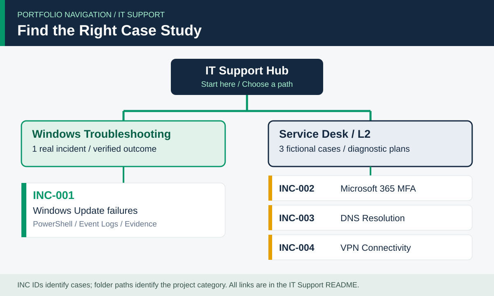
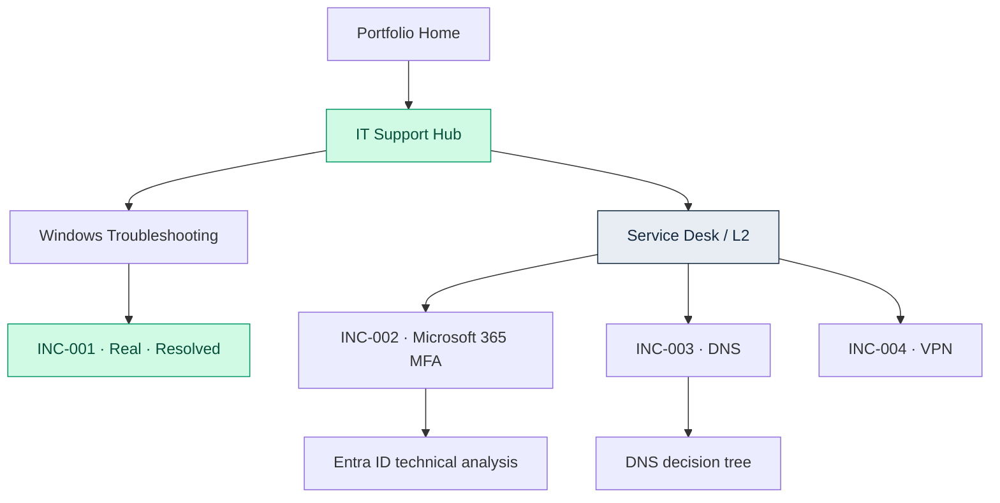
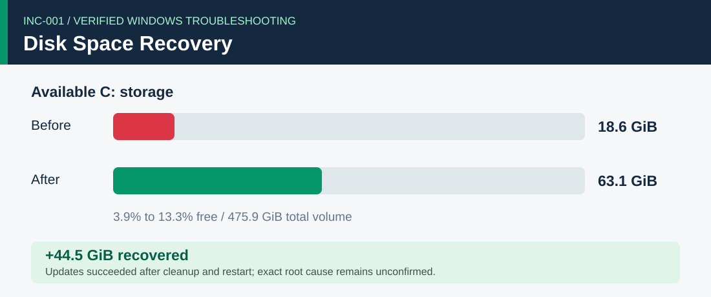
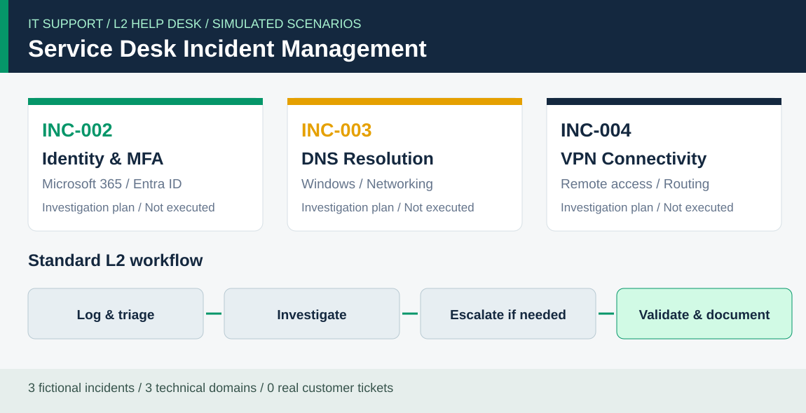

# IT Support & Troubleshooting

[← Portfolio Home](../README.md)

**Explore four documented incidents across two project areas.** This page is the navigation hub for Windows troubleshooting and L2 service desk work.

> **How to read the incident IDs:** `INC-001` to `INC-004` are portfolio case identifiers, not evidence that all incidents belong to one service desk queue. Each case is explicitly marked **Real** or **Simulated**.

## Choose Your Path

| Project area | Best starting point | What you will find | Evidence type |
|---|---|---|---|
| **[Windows Troubleshooting](Windows-Troubleshooting-Lab/README.md)** | [INC-001 — Windows Update and Application Troubleshooting](Windows-Troubleshooting-Lab/README.md) | Windows 11 diagnostics, PowerShell, event logs, storage remediation, and validation | **Real case — completed** |
| **[Service Desk Incident Management](Service-Desk-Incident-Management/README.md)** | [Service Desk L2 Overview](Service-Desk-Incident-Management/README.md) | Three case reports covering identity, DNS, and VPN, with investigation plans and escalation paths | **Simulated cases — documented** |

## All Incidents — Direct Access

| ID | Case study | Area | Status | Technical detail |
|---|---|---|---|---|
| **[INC-001](Windows-Troubleshooting-Lab/README.md)** | Windows Update / Application Update Failure | Windows Troubleshooting | **Real · Resolved** | [Sanitized evidence](Windows-Troubleshooting-Lab/evidence/validation-notes.md) |
| **[INC-002](Service-Desk-Incident-Management/incidents/INC-002-M365-Authentication.md)** | Microsoft 365 Authentication / MFA | Service Desk L2 | **Simulated · Not executed** | [Entra ID diagnostic analysis](Service-Desk-Incident-Management/incidents/INC-002-Technical-Analysis.md) |
| **[INC-003](Service-Desk-Incident-Management/incidents/INC-003-DNS-Resolution.md)** | DNS Resolution Failure | Service Desk L2 | **Simulated · Not executed** | [DNS decision tree](Service-Desk-Incident-Management/incidents/INC-003-DNS-Decision-Tree.md) |
| **[INC-004](Service-Desk-Incident-Management/incidents/INC-004-VPN-Connectivity.md)** | VPN Connected / Internal Resources Unavailable | Service Desk L2 | **Simulated · Not executed** | [VPN diagnostic workflow](Service-Desk-Incident-Management/incidents/INC-004-VPN-Connectivity.md#3-diagnostic-workflow) |

## Navigation Flow

## Featured Evidence — INC-001

**Verified:** Free disk space increased from **18.6 GiB to 63.1 GiB**, and application updates completed after cleanup and restart. **The precise root cause was not conclusively established.**

## L2 Incident Scenarios — Visual Overview

The Service Desk project contains three **fictional** incident scenarios. Troubleshooting commands, escalation decisions, and validation criteria are documented as proposed procedures, not real-world test results.

## Skills Demonstrated

**IT Support L1/L2 · Windows Troubleshooting · PowerShell · Event Log Analysis · Microsoft 365 / Entra ID · DNS · VPN · Incident Triage · Escalation · Security-Aware Documentation**

## How to Explore

Start with the **[real Windows incident](Windows-Troubleshooting-Lab/README.md)** for measured evidence, then review the **[L2 Service Desk scenarios](Service-Desk-Incident-Management/README.md)** for diagnostic reasoning and structured incident handling.

[← Back to Portfolio Home](../README.md)

---

*No confidential employer or customer data is published. All simulated work is explicitly identified.*
