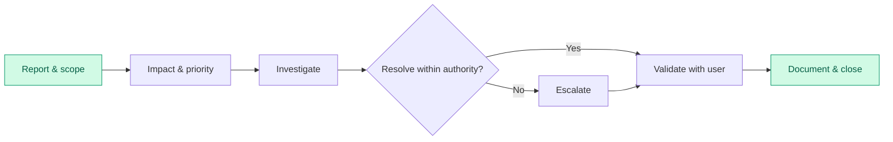

#  L2 Service Desk · Incident Case Studies

  

[← IT Support](../README.md) · [Portfolio](../../README.md)

Three incident scenarios explore situations an L2 technician may encounter: lost MFA access, DNS resolution failures, and VPN sessions that connect without reaching internal services.

**These are fictional cases.** The investigation steps are proposed and were not executed against a customer environment.

## Cases and technical follow-ups

| Incident | Main question | Related material |
|---|---|---|
| **[INC-002 · Microsoft 365 Authentication](incidents/INC-002-M365-Authentication.md)** | Is the issue with the user's MFA method, the account, or a Conditional Access requirement? | [Entra ID sign-in analysis](incidents/INC-002-Technical-Analysis.md) |
| **[INC-003 · DNS Resolution](incidents/INC-003-DNS-Resolution.md)** | Is the problem local configuration, the DNS resolver, or the route to the service? | [DNS decision tree](incidents/INC-003-DNS-Decision-Tree.md) |
| **[INC-004 · VPN Connectivity](incidents/INC-004-VPN-Connectivity.md)** | Is the tunnel actually usable, and where does access to internal resources fail? | [VPN diagnostic workflow](incidents/INC-004-VPN-Connectivity.md) |

## How the cases are handled

Identity verification, least privilege and escalation boundaries are part of the workflow—not steps to bypass when restoring service.

## Documentation

Use the [incident report template](templates/incident-report-template.md) to record impact, investigation, proposed changes, validation criteria and user communication.

**Scope note:** a well-documented troubleshooting plan is not the same as a verified production resolution. Findings and outcomes in these simulated cases are intentionally not presented as real customer tickets.

[← IT Support](../README.md)
