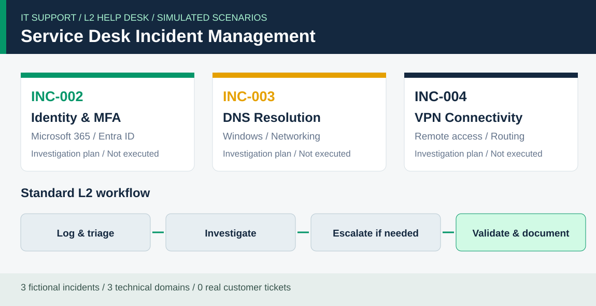

# Service Desk Incident Management — L2 Case Studies

[← IT Support Hub](../README.md) · [Portfolio Home](../../README.md)

**Scope:** Three fictional L2 incident scenarios; diagnostic plans only, not executed.

> **Portfolio simulation:** All incidents and organizations described in this project are fictional. The scenarios demonstrate technical troubleshooting methodology and do not represent actual customer tickets.

## Project Overview

This project demonstrates a structured approach to IT Service Desk Incident Management, focusing on Level 2 (L2) technical support, troubleshooting, incident prioritization, security awareness, and professional documentation.

The incident management workflow follows ITIL 4-aligned practices, emphasizing service restoration, business impact assessment, and effective communication.

## Project Objectives

- Document and classify IT incidents.
- Assess incident impact, urgency, and priority.
- Apply structured troubleshooting methodologies.
- Identify potential security risks.
- Document escalation and resolution procedures.
- Demonstrate professional technical communication.

## Incident Scenarios

| Incident ID | Description | Technology | Status |
|---|---|---|---|
| [INC-002](incidents/INC-002-M365-Authentication.md) | Microsoft 365 Authentication Failure | Microsoft 365 / Entra ID | Documented — simulated |
| [INC-003](incidents/INC-003-DNS-Resolution.md) | DNS Resolution Failure | Windows / DNS / Networking | Documented — simulated |
| [INC-004](incidents/INC-004-VPN-Connectivity.md) | VPN Connectivity Failure | VPN / Remote Access | Documented — simulated |

## Technical Deep Dives

- [INC-002 — Entra ID Sign-in Log Analysis](incidents/INC-002-Technical-Analysis.md)
- [INC-003 — DNS Decision Tree](incidents/INC-003-DNS-Decision-Tree.md)
- [Reusable Incident Report Template](templates/incident-report-template.md)

## Incident Management Workflow

1. **Incident Logging:** Record the issue and collect relevant information.
2. **Classification and Prioritization:** Evaluate impact, urgency, and business consequences.
3. **Investigation and Diagnosis:** Identify possible causes and perform troubleshooting.
4. **Escalation:** Involve specialized teams when necessary.
5. **Resolution and Validation:** Document corrective actions and verify service restoration.
6. **Incident Closure:** Record findings, user communication, and preventive recommendations.

## Skills Demonstrated

- IT Support L1/L2
- ITIL 4-aligned Incident Management
- Microsoft 365 and Identity Troubleshooting
- Network Troubleshooting
- Security Awareness
- Technical Documentation
- Incident Escalation
- Root Cause Analysis Fundamentals

## Project Disclaimer

This project is based on simulated enterprise IT incidents. Diagnostic procedures and proposed resolutions are documented for educational and portfolio purposes. They should be tested in an authorized environment before production use.

## References & Official Documentation

- [ITIL 4 — PeopleCert overview](https://www.peoplecert.org/browse-certifications/it-governance-and-service-management/ITIL-1)
- [Microsoft Entra sign-in logs](https://learn.microsoft.com/en-us/entra/identity/monitoring-health/concept-sign-ins)
- [Resolve-DnsName — PowerShell reference](https://learn.microsoft.com/en-us/powershell/module/dnsclient/resolve-dnsname)

*These references support the methodology and technical procedures; they do not independently validate execution, findings, or control effectiveness.*
