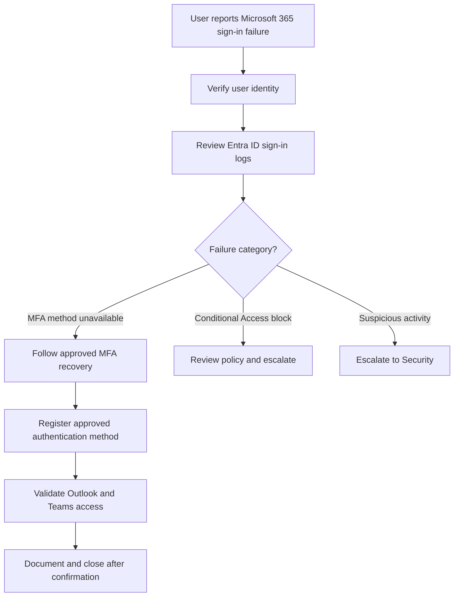

# INC-002 — Microsoft 365 Authentication Failure

[← Service Desk Overview](../README.md) · [IT Support Hub](../../README.md) · [Portfolio Home](../../../README.md)

**Incident Type:** User Authentication Issue  
**Category:** Identity and Access Management  
**Priority:** P3 — Medium (proposed; subject to organizational SLA)  
**Support Level:** L2 Helpdesk  
**Environment:** Microsoft 365 / Microsoft Entra ID  
**Status:** Simulated — Investigation and Resolution Plan

## Authentication Recovery Workflow

> **Simulation:** This is a proposed diagnostic workflow. No Microsoft 365 tenant or sign-in logs were accessed. MFA and Conditional Access should not be disabled as troubleshooting shortcuts.

## 1. Incident Description

A fictional employee reports being unable to access Microsoft 365 applications, including Outlook and Microsoft Teams, after replacing their mobile phone.

The employee can successfully sign in to their Windows workstation but cannot complete the Microsoft 365 authentication process.

**Reported error:** "Authentication request could not be completed."

## 2. Business Impact

- One employee is unable to access Microsoft 365 services.
- Email communication and collaboration are disrupted.
- No organization-wide outage has been reported.
- The employee's Windows workstation remains operational.

**Initial priority assessment:** P3 — Medium, assuming standard business impact and no time-critical activity.

## 3. Initial Troubleshooting

The L2 technician should:

1. Verify the employee's identity using an approved verification procedure.
2. Confirm the affected applications and authentication error.
3. Determine whether the issue began after the mobile device replacement.
4. Check the user's account status in Microsoft Entra ID.
5. Review Microsoft Entra sign-in logs for authentication failures.
6. Identify whether the failure is related to MFA, Conditional Access, or another authentication requirement.
7. Confirm whether the user has an alternative registered authentication method.

## 4. Diagnostic Hypothesis

**Primary hypothesis:** The employee's Microsoft Authenticator registration is associated with their previous mobile device, preventing successful MFA verification.

**Alternative causes:**

- Conditional Access policy requirements.
- Account lockout or disabled account.
- Authentication method registration issues.
- Temporary Microsoft 365 service disruption.

The root cause remains unconfirmed until the relevant sign-in evidence is reviewed.

## 5. Proposed Resolution Procedure

If investigation confirms that the employee no longer has access to their registered authentication method:

1. Complete the organization's approved identity verification process.
2. Follow the authorized MFA recovery procedure.
3. If permitted, issue a Temporary Access Pass or require re-registration of authentication methods using an approved recovery workflow.
4. Register Microsoft Authenticator on the new mobile device.
5. Confirm successful MFA authentication.
6. Verify access to Outlook and Microsoft Teams.
7. Document the changes and notify the employee.

**Security consideration:** Do not disable MFA or bypass Conditional Access solely to restore access. Escalate requests that fall outside approved recovery procedures.

## 6. Validation Criteria

The incident can be considered resolved when:

- The employee successfully authenticates to Microsoft 365.
- The new MFA method is registered and functioning.
- Outlook and Microsoft Teams are accessible.
- The employee confirms service restoration.
- The incident record contains the relevant troubleshooting and recovery details.

## 7. Escalation Criteria

Escalate to the Identity or Security team when:

- Suspicious sign-in activity is detected.
- The employee cannot pass identity verification.
- Conditional Access policies require modification.
- Unauthorized MFA registration changes are suspected.
- The technician lacks permission to perform the recovery.

## 8. Incident Closure

**Outcome:** Not executed — simulated incident.

**Proposed resolution:** Recover the employee's approved authentication method and validate Microsoft 365 access.

**Root cause:** Hypothesized MFA registration issue; not independently verified.

**Lessons Learned:**

- Identity verification is essential during MFA recovery.
- Authentication logs help distinguish MFA failures from policy or account issues.
- Security controls must remain enforced during incident resolution.
- Accurate documentation improves escalation and future troubleshooting.

---

## Portfolio Disclaimer

This incident is a fictional enterprise support scenario. No real Microsoft 365 tenant was accessed, no user account was modified, and no production remediation was performed.

## References & Official Documentation

- [Manage authentication methods in Microsoft Entra](https://learn.microsoft.com/en-us/entra/identity/authentication/concept-authentication-methods-manage)
- [Microsoft Entra sign-in logs](https://learn.microsoft.com/en-us/entra/identity/monitoring-health/concept-sign-ins)
- [Microsoft Entra Conditional Access overview](https://learn.microsoft.com/en-us/entra/identity/conditional-access/overview)

*These references support the methodology and technical procedures; they do not independently validate execution, findings, or control effectiveness.*
