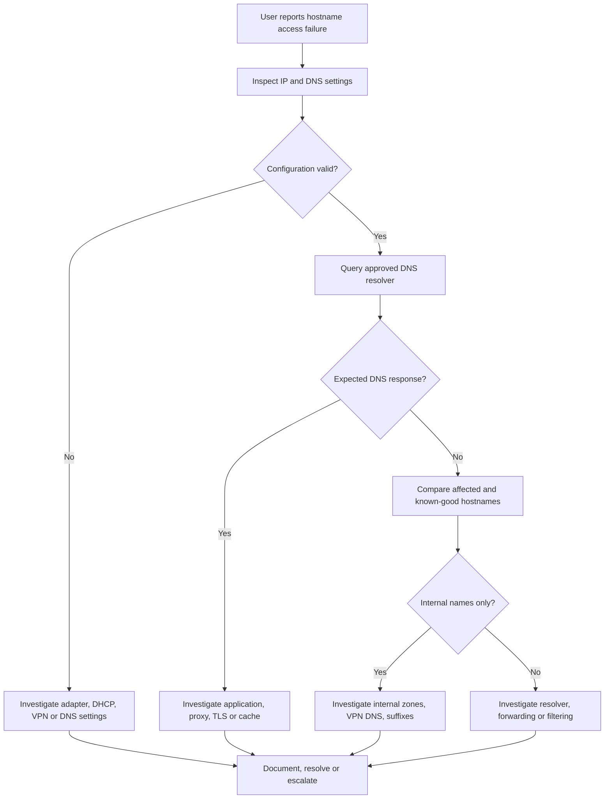

# INC-003 — DNS Troubleshooting Decision Tree

**Related incident:** [INC-003 — Corporate DNS Resolution Failure](INC-003-DNS-Resolution.md)  
**Support level:** L2 Helpdesk  
**Status:** Simulated — diagnostic reference; not executed

## Diagnostic Flow

## Decision Guide

| Check | Command | Interpretation |
|---|---|---|
| Client configuration | `ipconfig /all` | Review addresses, gateway, DNS server and suffixes |
| Name resolution | `Resolve-DnsName www.microsoft.com` | Check whether the configured resolver returns the expected response |
| Approved resolver comparison | `Resolve-DnsName www.microsoft.com -Server <APPROVED_DNS_IP>` | Compare results only with an authorized resolver |
| DNS service TCP reachability | `Test-NetConnection <APPROVED_DNS_IP> -Port 53` | TCP 53 check only; DNS also commonly uses UDP, so failure is not conclusive |
| Client DNS cache | `ipconfig /displaydns` | Inspect cached results before considering a flush |

Replace placeholder addresses with approved organizational values. Never expose internal hostnames to unauthorized public DNS resolvers.

## Escalation

Escalate when corporate DNS services are unavailable, multiple users are affected, zone or forwarding changes are needed, or security controls may be involved.

## Evidence and Limitations

This is a proposed diagnostic workflow, not a log of executed commands. Record actual outputs and validate any corrective action in an authorized environment before marking a real incident resolved.
