# INC-003 — Corporate DNS Resolution Failure

[← Service Desk Overview](../README.md) · [IT Support Hub](../../README.md) · [Portfolio Home](../../../README.md)

**Incident Type:** Network Connectivity / DNS Resolution  
**Category:** Networking  
**Priority:** P3 — Medium (proposed; subject to organizational SLA)  
**Support Level:** L2 Helpdesk  
**Environment:** Windows 11 Enterprise / Corporate Network  
**Status:** Simulated — Investigation and Resolution Plan

## DNS Troubleshooting Workflow

```mermaid
flowchart TD
    A[Hostname access failure reported] --> B[Review ipconfig /all]
    B --> C{Valid IP and approved DNS settings?}
    C -->|No| D[Investigate adapter, DHCP or VPN]
    C -->|Yes| E[Query approved DNS resolver]
    E --> F{Expected DNS response?}
    F -->|Yes| G[Investigate application, proxy or cache]
    F -->|No| H[Compare internal and external names]
    H --> I{Internal names only?}
    I -->|Yes| J[Investigate internal zones and VPN DNS]
    I -->|No| K[Investigate resolver, forwarding or filtering]
    D --> L[Document findings and resolve or escalate]
    G --> L
    J --> L
    K --> L
```



> **Simulation:** These are decision points, not recorded test results. Use only authorized DNS resolvers and preserve corporate security controls.

## 1. Incident Description

A fictional employee reports being unable to access corporate web applications and selected external websites using their domain names.

The workstation appears to maintain IP connectivity, but DNS resolution is suspected to be failing.

**Reported symptoms:**

- Corporate applications fail to load by hostname.
- Some websites display DNS-related errors.
- The workstation remains connected to the corporate network.
- No organization-wide outage has been confirmed.

## 2. Business Impact

- One employee experiences disrupted access to business applications.
- Productivity is reduced.
- Network connectivity appears partially functional.
- The scope of the incident requires further investigation.

**Initial priority:** P3 — Medium, assuming a single affected user and no critical business interruption.

## 3. Initial Troubleshooting

### Step 1 — Review Network Configuration

Open Command Prompt and execute:

```cmd
ipconfig /all
```

**Objective:**

Identify the workstation's IP address, subnet mask, default gateway, and configured DNS servers.

**Expected findings:**

- Valid IP configuration.
- DNS servers consistent with corporate network requirements.
- No unexpected network adapter configuration.

**Execution status:** Not tested.

### Step 2 — Verify IP Connectivity

```cmd
ping 1.1.1.1
```

**Objective:**

Check whether the workstation can reach an external IP address without relying on DNS.

**Interpretation:**

A successful response supports basic IP connectivity to the destination. A failed response is inconclusive because ICMP traffic may be filtered.

**Execution status:** Not tested.

### Step 3 — Test DNS Resolution

```cmd
nslookup www.microsoft.com
```

**Objective:**

Determine whether the configured DNS resolver can resolve a known external domain.

**Potential findings:**

- Successful DNS response.
- DNS timeout.
- Server unavailable.
- Unexpected DNS server response.

**Execution status:** Not tested.

### Step 4 — Compare DNS Resolvers

```cmd
nslookup www.microsoft.com 1.1.1.1
```

**Objective:**

Compare DNS resolution against a public DNS resolver, where permitted by corporate security policy.

**Important:**

Public DNS queries may be blocked or prohibited in enterprise environments. Testing must follow organizational policy.

**Execution status:** Not tested.

### Step 5 — Review the DNS Client Cache

```cmd
ipconfig /displaydns
```

**Objective:**

Inspect cached DNS records and identify potentially outdated entries.

If approved and appropriate, clear the DNS resolver cache:

```cmd
ipconfig /flushdns
```

**Important:** Flushing the DNS cache is a corrective action, not proof that cached records caused the issue.

**Execution status:** Not tested.

### Step 6 — PowerShell DNS Diagnostics

```powershell
Resolve-DnsName www.microsoft.com
```

**Objective:**

Inspect DNS resolution results using a native PowerShell command.

Additional diagnostic options may include querying a specific DNS server:

```powershell
Resolve-DnsName www.microsoft.com -Server 1.1.1.1
```

**Execution status:** Not tested.

## 4. Root Cause Analysis

**Initial hypotheses:**

1. Incorrect DNS server configuration.
2. DNS server unavailability.
3. DNS client cache inconsistencies.
4. VPN-related DNS configuration problems.
5. DNS filtering or security policy restrictions.

**Confirmed root cause:** Not established.

A valid root cause determination requires actual diagnostic results and supporting evidence.

## 5. Proposed Resolution Procedure

Depending on the diagnostic findings:

1. Verify the workstation's DNS configuration against approved corporate settings.
2. Confirm reachability and availability of the configured DNS servers.
3. Review VPN DNS settings if the user is working remotely.
4. Flush the DNS cache only when appropriate.
5. Correct unauthorized or incorrect DNS configuration through approved change procedures.
6. Escalate suspected DNS infrastructure failures to the Network or Infrastructure team.

## 6. Validation Criteria

The incident may be considered resolved when:

- The workstation resolves the affected corporate hostnames.
- The employee can access the required business applications.
- DNS queries return the expected records from authorized resolvers.
- No unintended network configuration changes remain.
- The employee confirms service restoration.

**Validation status:** Not performed.

## 7. Escalation Criteria

Escalate to the Network or Infrastructure team when:

- Multiple users report similar DNS failures.
- Corporate DNS servers are unavailable.
- DNS forwarding or internal zone configuration appears incorrect.
- DNS-related security controls may be involved.
- The required corrective action exceeds L2 permissions.

## 8. Security Considerations

- Do not replace corporate DNS servers with public resolvers without authorization.
- Avoid exposing internal DNS records to unauthorized external services.
- Document network configuration changes.
- Investigate unexpected DNS server addresses.
- Escalate suspected DNS manipulation or poisoning.

## 9. Incident Closure

**Outcome:** Not executed — simulated incident.

**Proposed resolution:** Identify the failing DNS component, apply an authorized corrective action, and validate name resolution.

**Root cause:** Unconfirmed.

**Lessons learned:**

- IP connectivity and DNS resolution must be investigated separately.
- DNS configuration should be validated before applying changes.
- Public DNS resolvers are diagnostic alternatives only when permitted.
- Structured troubleshooting improves incident documentation and escalation.

---

## Portfolio Disclaimer

This is a fictional enterprise support scenario. No production DNS configuration was modified, and no diagnostic commands were executed as part of this case study.

## References & Official Documentation

- [Resolve-DnsName — PowerShell reference](https://learn.microsoft.com/en-us/powershell/module/dnsclient/resolve-dnsname)
- [DnsClient PowerShell module](https://learn.microsoft.com/en-us/powershell/module/dnsclient)
- [DNS overview — Microsoft Learn](https://learn.microsoft.com/en-us/windows-server/networking/dns/dns-overview)

*These references support the methodology and technical procedures; they do not independently validate execution, findings, or control effectiveness.*
