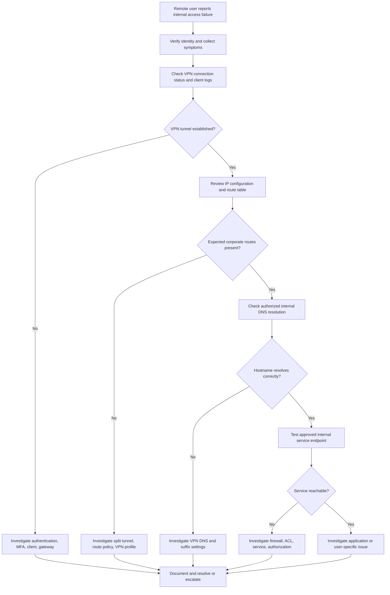

# INC-004 — Corporate VPN Connectivity Failure

[← Service Desk Overview](../README.md) · [IT Support Hub](../../README.md) · [Portfolio Home](../../../README.md)

**Incident Type:** Remote Access / Network Connectivity  
**Category:** Networking and Remote Access  
**Priority:** P3 — Medium (proposed; subject to business impact and organizational SLA)  
**Support Level:** L2 Helpdesk  
**Environment:** Windows 11 / Corporate VPN / Internal Business Applications  
**Status:** Simulated — Investigation and Resolution Plan

> **Portfolio simulation:** This is a fictional support incident. No production VPN connection, corporate network, or user account was accessed.

## Incident at a Glance

| Field | Details |
|---|---|
| Incident ID | INC-004 |
| Reported by | Fictional remote employee |
| Symptom | VPN client reports connected, but internal applications are inaccessible |
| Scope | One remote user; broader impact not established |
| Impact | Medium — business applications unavailable |
| Urgency | Medium — assuming no time-critical business interruption |
| Priority | P3 — Medium (provisional) |
| Assigned team | L2 Service Desk |
| Root cause | Unconfirmed |
| Resolution | Proposed; not executed |
| Validation | Not performed |

## 1. Incident Description

A fictional remote employee reports that the corporate VPN client displays **Connected**, but internal web applications and a corporate file share cannot be reached.

The employee can browse public websites normally. The issue reportedly began after reconnecting to the VPN from a home network.

The VPN client's connected status alone does not prove that the correct routes, DNS settings, access permissions, or application connectivity are working.

## 2. Business Impact

- One remote employee cannot access required internal services.
- Public internet connectivity appears available.
- No widespread VPN outage has been confirmed.
- Priority should be reassessed if additional users or business-critical services are affected.

## 3. Diagnostic Workflow



*Illustrative diagnostic flow; branches are hypotheses, not observed results.*

## 4. Initial Troubleshooting

### Step 1 — Confirm the Scope and Security Context

- Verify the employee's identity using the approved helpdesk process.
- Record the VPN client, reported error, connection timestamp, and affected applications.
- Determine whether other users or devices are affected.
- Check whether the user recently changed devices, networks, credentials, or MFA methods.
- Review the organization's VPN service status and approved incident communications.

**Execution status:** Not tested.

### Step 2 — Inspect Network Configuration

Run on the authorized Windows endpoint:

```powershell
ipconfig /all
Get-NetIPConfiguration
```

**Objective:** Review VPN adapter addressing, DNS server assignments, and the physical network configuration.

**Interpretation:** An active VPN adapter does not by itself establish reachability to internal resources.

**Execution status:** Not tested.

### Step 3 — Review Routes

```powershell
route print
Get-NetRoute -AddressFamily IPv4 |
    Sort-Object InterfaceIndex, DestinationPrefix |
    Select-Object DestinationPrefix, NextHop, InterfaceAlias, RouteMetric
```

**Objective:** Determine whether routes for authorized internal networks are present and associated with the expected interface.

**Important:** Split-tunnel VPNs do not necessarily route all traffic through the VPN. Compare routes against the organization's approved design rather than assuming a default route is required.

**Execution status:** Not tested.

### Step 4 — Test Internal DNS Resolution

Replace the placeholder with an approved internal hostname:

```powershell
Resolve-DnsName intranet.example.test
```

**Objective:** Check whether the endpoint resolves an internal resource using the intended corporate DNS path.

**Interpretation:** DNS failure may indicate VPN DNS assignment, suffix search, conditional forwarding, or resolver reachability problems. A successful response does not guarantee application access.

**Execution status:** Not tested.

### Step 5 — Check an Approved Application Endpoint

For an internal HTTPS service, where authorized:

```powershell
Test-NetConnection intranet.example.test -Port 443
```

**Objective:** Check TCP connectivity to a specific application port.

**Interpretation:** A successful TCP connection supports transport reachability but does not verify HTTP application health, user authorization, or end-to-end service functionality.

**Execution status:** Not tested.

### Step 6 — Review VPN Client and Gateway Evidence

If the technician has appropriate access, review:

- VPN client connection events and error messages.
- Authentication and MFA outcomes.
- VPN gateway session status.
- Assigned VPN address and user/group policy.
- Access control and firewall logs.
- Relevant device compliance requirements.

Do not copy credentials, tokens, or confidential connection logs into a public repository.

**Execution status:** Not tested.

## 5. Diagnostic Hypotheses

| Finding | Possible Cause | Next Action |
|---|---|---|
| VPN authentication fails | Credentials, MFA, account, device compliance, or gateway issue | Review approved identity and VPN logs |
| Tunnel connected, corporate route absent | VPN route or split-tunnel policy issue | Compare route table with approved VPN design |
| Internal hostname fails to resolve | VPN DNS configuration or internal resolver issue | Review approved DNS configuration |
| Host resolves but TCP service fails | Firewall, ACL, routing, service availability, or endpoint issue | Test authorized endpoint and escalate |
| TCP succeeds but application rejects access | Application authorization or session issue | Review application-specific logs and permissions |

**Confirmed root cause:** Not established.

## 6. Proposed Resolution and Recovery

Apply only actions supported by diagnostic evidence and authorized by organizational procedures:

1. Verify that the user is assigned the correct VPN profile and access policy.
2. Confirm required authentication and MFA steps.
3. Correct an identified client configuration issue using approved settings.
4. Escalate missing corporate routes, DNS policy issues, or gateway failures to Network/Infrastructure.
5. Escalate suspicious sign-in activity or unauthorized access changes to Security.
6. Reconnect and retest affected services after an approved corrective action.
7. Record the action taken, results, and rollback approach.

**Do not** disable MFA, endpoint protection, firewall rules, or VPN security controls merely to restore connectivity.

## 7. Validation Criteria

| Check | Expected Outcome | Status |
|---|---|---|
| VPN session | Authenticated and established | Not tested |
| Corporate route | Expected route present according to VPN design | Not tested |
| Internal DNS | Approved hostname resolves as expected | Not tested |
| Internal application | Authorized service accessible | Not tested |
| User confirmation | Employee confirms restored workflow | Not tested |

**Validation status:** Not performed.

## 8. Escalation Criteria

Escalate when:

- Multiple remote employees are affected.
- VPN gateway or corporate DNS infrastructure is unavailable.
- Firewall, ACL, or routing changes are required.
- Authentication or device compliance controls are involved.
- Suspicious activity or unauthorized access is suspected.
- The required action exceeds L2 permissions.

Include a sanitized symptom summary, scope, timestamps, client status, relevant error codes, route/DNS observations, and the tests performed.

## 9. Example User Communication

**Acknowledgment (sample; not sent):**

> We have received your report that the VPN is connected but internal resources are unavailable. We are checking the connection configuration and access path. We will provide an update after the initial investigation.

**Progress update (sample; not sent):**

> We are reviewing VPN routing and internal name resolution to determine whether the issue is related to connectivity or access permissions. No changes to security controls have been made.

## 10. Incident Closure

**Outcome:** Not executed — simulated incident.  
**Root cause:** Unconfirmed.  
**Proposed resolution:** Identify the failing VPN, routing, DNS, or application access component; apply an authorized correction; validate service restoration.  
**User confirmation:** Not applicable — simulated case.

### Lessons Learned

- A VPN client showing *Connected* does not guarantee internal service access.
- VPN routing, DNS resolution, and application authorization are separate diagnostic layers.
- Split-tunnel behavior must be evaluated against the approved network design.
- Security controls should remain enforced throughout troubleshooting.
- Accurate evidence and escalation notes reduce repeat investigation.

---

## Portfolio Disclaimer

This is a fictional enterprise support case study. Commands are examples and have not been executed for this scenario. No production network changes or user recovery actions were performed.

## References & Official Documentation

- [Get-NetRoute — PowerShell reference](https://learn.microsoft.com/en-us/powershell/module/nettcpip/get-netroute)
- [Test-NetConnection — PowerShell reference](https://learn.microsoft.com/en-us/powershell/module/nettcpip/test-netconnection)
- [Resolve-DnsName — PowerShell reference](https://learn.microsoft.com/en-us/powershell/module/dnsclient/resolve-dnsname)
- [Remote Access overview — Microsoft Learn](https://learn.microsoft.com/en-us/windows-server/remote/remote-access/remote-access)

*These references support the methodology and technical procedures; they do not independently validate execution, findings, or control effectiveness.*
