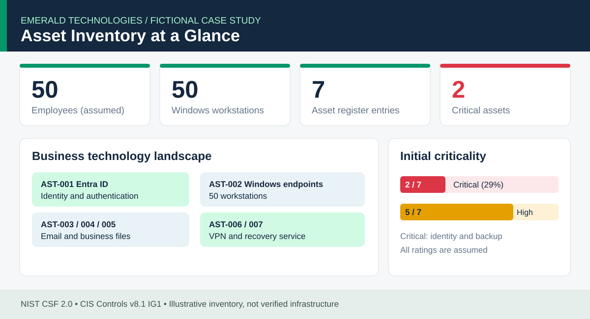
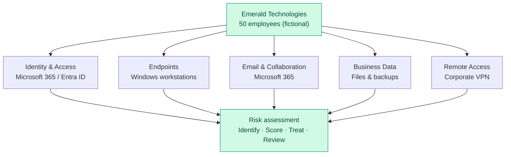
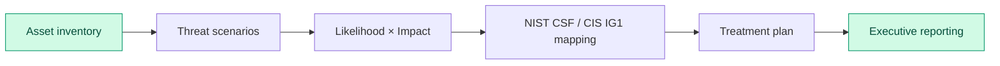
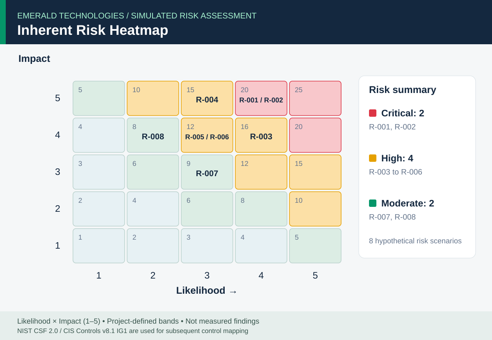
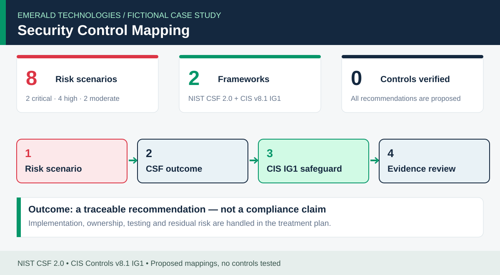
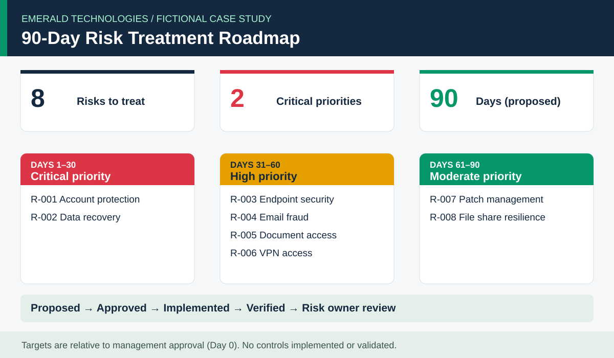
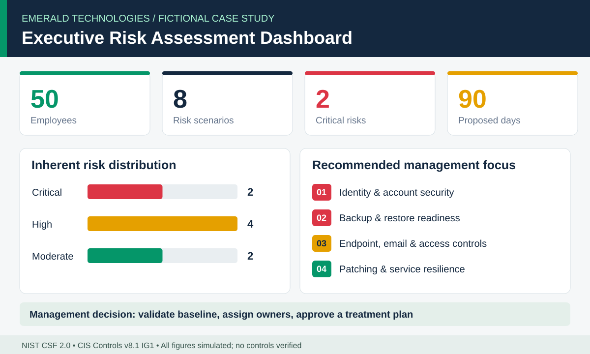

# Enterprise Information Security Risk Assessment

**Framework references:** NIST Cybersecurity Framework (CSF) 2.0 · CIS Controls v8.1, Implementation Group 1 (IG1)  
**Organization:** Emerald Technologies (fictional)  
**Project type:** Portfolio case study — simulated assessment  
**Status:** Documentation complete — simulated; no controls implemented or validated

## Executive Overview

This project develops a practical, qualitative information security risk assessment for **Emerald Technologies**, a fictional 50-person organization. The assessment focuses on identity and access, Windows endpoints, email threats, backups, and remote access.

The goal is to demonstrate how an IT and cybersecurity professional can identify important assets, assess risk, prioritize security improvements, and communicate actionable recommendations to business stakeholders.

> **Evidence disclaimer:** All organizational details, asset inventories, ratings, and findings are fictional. No production environment was assessed. This is an educational portfolio exercise, not a certification or compliance audit.

## Visual Organization Overview

> **Illustrative figures:** Emerald Technologies is fictional. The 50 employees and the five security domains below are assumptions for this portfolio case study, not observed operational metrics.

| 👥 Employees | 🛡️ Security domains | 📋 Assessment approach | 📚 Frameworks |
|:---:|:---:|:---:|:---:|
| **50** | **5** | **5 × 5** risk matrix | **2** |
| Assumed headcount | Identity · Endpoints · Email · Backup · VPN | Project-defined scoring | NIST CSF 2.0 · CIS v8.1 IG1 |

### Illustrative Technology Landscape

### Assessment Workflow

## Business Context and Scope

### Assumed environment

- Approximately 50 employees using Windows workstations.
- Microsoft 365 for email, collaboration, and identity services.
- Remote access for selected staff through a corporate VPN.
- Business files stored in approved cloud and/or on-premises services.
- A small internal IT function responsible for user support and administration.

### In scope

- Identity and authentication controls.
- Endpoint configuration, patching, and protection.
- Phishing and email-related threats.
- Business data backup and recovery.
- Remote access and privileged access.

### Out of scope

- Physical penetration testing or offensive security testing.
- Formal legal or regulatory compliance certification.
- Live vulnerability scanning or access to real customer systems.
- Quantitative financial loss modeling.

## Assessment Approach

This case study uses a **qualitative 5 × 5 risk matrix** defined specifically for this project. NIST CSF 2.0 is used to organize cybersecurity outcomes, and CIS Controls v8.1 IG1 is used to identify practical baseline safeguards. Neither framework is presented as prescribing this particular scoring model.

1. Identify business processes, information assets, and asset owners.
2. Describe relevant threats, vulnerabilities, and potential business consequences.
3. Score inherent likelihood and impact on a 1–5 scale.
4. Calculate an initial risk score: **Likelihood × Impact**.
5. Identify existing *assumed* controls and relevant gaps.
6. Map proposed improvements to NIST CSF 2.0 outcomes and applicable CIS IG1 safeguards.
7. Recommend risk treatment, owners, target dates, and validation evidence.
8. Reassess residual risk only when controls and assumptions are sufficiently documented.

### Risk scoring (project-defined)

| Score | Rating | Interpretation |
|---|---|---|
| 1–4 | Low | Monitor and manage through routine controls |
| 5–9 | Moderate | Plan proportionate improvements |
| 10–16 | High | Prioritize treatment and management review |
| 17–25 | Critical | Prompt management attention and risk treatment planning |

**Likelihood scale:** 1 = Rare, 2 = Unlikely, 3 = Possible, 4 = Likely, 5 = Almost certain.  
**Impact scale:** 1 = Negligible, 2 = Minor, 3 = Moderate, 4 = Major, 5 = Severe.

Scores are illustrative and should not be interpreted as measured probabilities or financial losses. Risk acceptance requires an authorized business decision.

## Framework Usage

### NIST CSF 2.0

The six CSF Functions — **Govern, Identify, Protect, Detect, Respond, and Recover** — provide a structure for organizing cybersecurity outcomes and communicating priorities. Relevant Categories and Subcategories will be cited in the control mapping as the assessment develops.

### CIS Controls v8.1 — Implementation Group 1

IG1 is a prioritized baseline of essential cyber hygiene safeguards. The treatment plan will map applicable recommendations to specific IG1 safeguards rather than claiming that implementing IG1 alone guarantees security or compliance.

## Risk Assessment Preview

*Eight fictional scenarios: 2 Critical, 4 High, 2 Moderate. Scores are assumptions, not verified findings.*

## Security Control Mapping Preview

*Candidate safeguards only; no control implementation or effectiveness has been verified.*

## Risk Treatment Roadmap Preview

*Proposed sequencing only. No controls have been implemented or verified.*

## Risk Distribution

*25% Critical, 50% High and 25% Moderate among the eight illustrative scenarios.*

## Executive Dashboard

*Management-facing summary of eight fictional scenarios and a proposed 90-day response.*

## Project Deliverables

| Deliverable | Purpose | Status |
|---|---|---|
| [Asset Inventory](assets/asset-inventory.md) | Identify assets, business value, and ownership | **Completed — simulated** |
| [Risk Register](risk-register/risk-register.md) | Document scenarios and inherent risk scores | **Completed — simulated** |
| [Control Mapping](controls/control-mapping.md) | Map risk treatment to CSF 2.0 and CIS IG1 | **Completed — proposed** |
| [Risk Treatment Plan](treatment/risk-treatment-plan.md) | Assign mitigation actions and validation criteria | **Completed — proposed** |
| [Executive Summary](reports/executive-summary.md) | Communicate priorities to management | **Completed — simulated** |

## Intended Skills Demonstrated

- Information security risk assessment
- Business impact and likelihood analysis
- Asset identification and ownership
- NIST CSF 2.0 outcome mapping
- CIS Controls v8.1 IG1 safeguard selection
- Risk treatment prioritization
- Security documentation and executive communication

## References & Official Documentation

- [NIST Cybersecurity Framework 2.0](https://www.nist.gov/cyberframework)
- [CIS Controls v8.1 Navigator — safeguard and implementation-group details](https://www.cisecurity.org/controls/cis-controls-navigator)
- [NIST SP 800-30 Rev. 1 — Guide for Conducting Risk Assessments](https://csrc.nist.gov/pubs/sp/800/30/r1/final)

*These references support the methodology and technical procedures; they do not independently validate execution, findings, or control effectiveness.*

---

*This repository documents a fictional assessment for learning and portfolio demonstration. It does not claim an actual organizational assessment, implemented controls, or verified compliance.*
