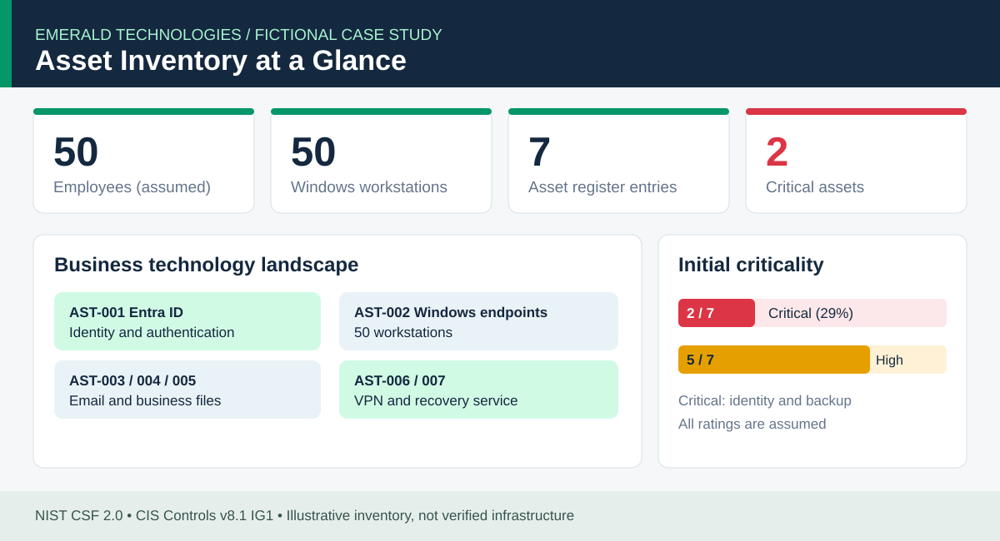
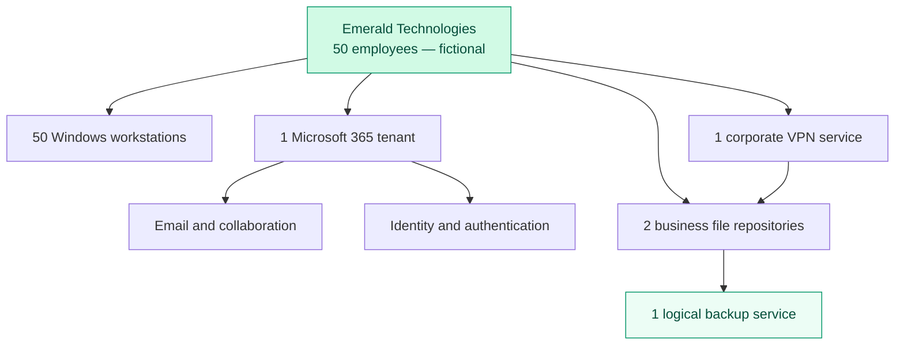

# Asset Inventory — Emerald Technologies

**Project:** Enterprise Information Security Risk Assessment  
**Organization:** Emerald Technologies (fictional)  
**Framework context:** NIST CSF 2.0 / CIS Controls v8.1 IG1  
**Assessment status:** Simulated baseline — not verified against a real environment

## 1. Purpose and Assumptions

This inventory establishes a **fictional planning baseline** for identifying assets, business dependencies, accountable owners, and security priorities. It is a scenario-level inventory, **not** a verified device-by-device CMDB or a record of assets discovered through scanning.

### Fictional organization profile

| Metric | Assumed value | Notes |
|---|---:|---|
| Employees | **50** | Fictional company headcount |
| Windows workstations | **50** | Planning assumption: one managed workstation per employee |
| Microsoft 365 tenant | **1** | Shared identity, email, and collaboration environment |
| Corporate VPN service | **1** | Used by authorized remote staff; number of users not yet specified |
| Business file repositories | **2** | One cloud collaboration repository and one internal shared-file repository |
| Backup service | **1** | Logical service; actual backup coverage and recovery performance unknown |
| Asset domains assessed | **5** | Identity, endpoints, email, business data/backup, remote access |

**Counting rule:** These metrics describe different asset types and must not be added together as though they were all physical devices. Microsoft 365 supports more than one security domain, and the backup service is a logical dependency.

## 2. Visual Asset Landscape

*Architecture is illustrative. Connections indicate conceptual business dependencies, not validated network topology or backup coverage.*

## 3. Asset Register

**Criticality definitions:** Critical = a failure could severely interrupt essential operations or security; High = significant operational disruption; Medium = limited or recoverable disruption. These ratings are **initial analyst assumptions**, not stakeholder-approved classifications.

| ID | Asset / service | Type | Quantity / scope | Business owner (role) | Technical custodian (role) | Criticality | Key security concern |
|---|---|---|---|---|---|---|---|
| AST-001 | Microsoft Entra ID identities | Identity service | 1 tenant / up to 50 employee identities | Operations Manager | IT Administrator | Critical | Account compromise, weak MFA recovery |
| AST-002 | Windows employee workstations | Endpoint fleet | 50 devices | Department Managers | IT Support | High | Malware, missing patches, lost devices |
| AST-003 | Microsoft 365 email and collaboration | SaaS service | 1 tenant | Operations Manager | M365 Administrator | High | Phishing, mailbox compromise, data sharing |
| AST-004 | Cloud collaboration file repository | Information repository | 1 logical repository | Department Managers | M365 Administrator | High | Unauthorized access, accidental deletion |
| AST-005 | Internal shared-file repository | Information repository | 1 logical repository | Operations Manager | Infrastructure Administrator | High | Excessive permissions, service disruption |
| AST-006 | Corporate VPN | Remote access service | 1 service | Operations Manager | Network Administrator | High | Unauthorized remote access, configuration errors |
| AST-007 | Backup and recovery service | Recovery capability | 1 logical service | Operations Manager | Infrastructure Administrator | Critical | Failed restores, incomplete backup coverage |

**Ownership convention:** A *business owner* is accountable for business requirements and risk decisions. A *technical custodian* maintains the service and implements approved controls. Role assignments are fictional and should be validated in a real assessment.

## 4. Information Classification

| Information category | Example | Proposed classification | Main protection objective |
|---|---|---|---|
| Employee identity and HR records | Employee account details and HR documents | Confidential | Confidentiality and integrity |
| Business correspondence | Customer and supplier email | Internal / Confidential depending on content | Confidentiality and availability |
| Operational documents | Procedures, contracts, project files | Internal / Confidential depending on content | Integrity and availability |
| Public marketing materials | Published company information | Public | Integrity |
| Backup copies | Protected copies of business information | Match the source data classification | Confidentiality, integrity, recoverability |

**Note:** These are proposed handling categories for the fictional organization; they are not a claim of regulatory classification or a substitute for a formally approved information classification policy.

## 5. Business Dependencies

| Business capability | Supporting assets | Potential disruption |
|---|---|---|
| Employee sign-in and access | AST-001, AST-002 | Employees cannot authenticate or access assigned systems |
| Corporate communication | AST-001, AST-003 | Email and collaboration interruptions |
| Business document access | AST-001, AST-004, AST-005, AST-006 for remote access | Employees cannot access required files |
| Remote operations | AST-001, AST-002, AST-006 | Remote staff lose access to internal services |
| Data recovery | AST-004, AST-005, AST-007 | Data restoration may be delayed or unsuccessful |

## 6. Initial Security Review Questions

The following are **assessment questions**, not confirmed deficiencies:

- Are all employee accounts protected by approved MFA methods?
- Is there a maintained, reconciled inventory of all 50 assumed workstations?
- Are endpoint security updates and protective controls monitored?
- Are shared-file permissions reviewed and restricted to business need?
- Are backups protected, monitored, and periodically restore-tested?
- Is VPN access restricted to authorized users and managed devices?
- Are privileged accounts separated from standard user accounts?

## 7. NIST CSF and CIS IG1 Relevance

This inventory supports asset and risk identification activities in the **IDENTIFY** function of NIST CSF 2.0, including asset management. It also creates a basis for evaluating applicable **CIS Controls v8.1 IG1** safeguards related to enterprise asset inventory, software inventory, account management, access control, data protection, and data recovery.

Specific framework subcategories and safeguards will be cross-referenced in the dedicated control mapping document. Framework alignment is proposed, not independently audited.

## 8. Evidence and Limitations

**Verified observations:** None — fictional scenario.  
**Inventory completeness:** Not verifiable without an authorized discovery process.  
**Ownership confirmation:** Not performed.  
**Criticality approval:** Not performed.  
**Next step:** Develop a risk register with explicit threat scenarios, likelihood, impact, and treatment assumptions.

## References & Official Documentation

- [NIST Cybersecurity Framework 2.0 — Identify and asset management](https://www.nist.gov/cyberframework)
- [CIS Controls v8.1 Navigator — enterprise asset and software inventories](https://www.cisecurity.org/controls/cis-controls-navigator)

*These references support the methodology and technical procedures; they do not independently validate execution, findings, or control effectiveness.*

---

*Portfolio case study. All numbers and asset records are fictional assumptions created for educational risk assessment.*
