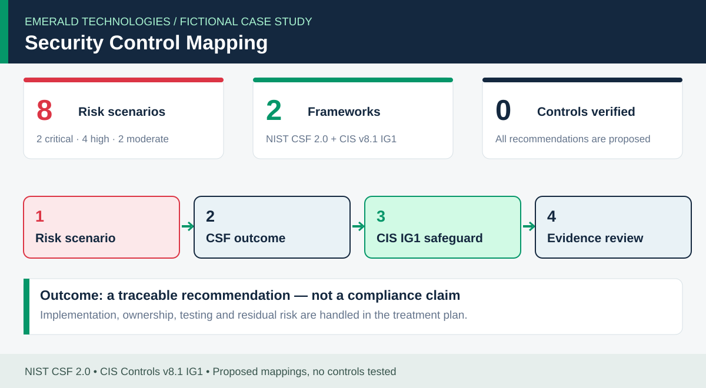
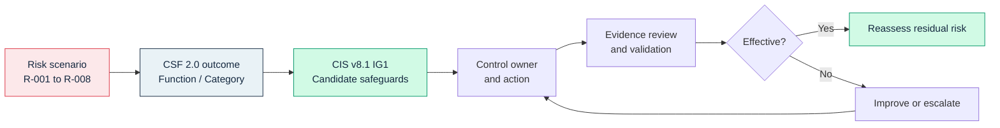

# Security Control Mapping — Emerald Technologies

**Case study:** Emerald Technologies — fictional 50-person organization  
**Assessment scope:** Eight hypothetical inherent risks (R-001 to R-008)  
**References:** NIST CSF 2.0 and CIS Controls v8.1, Implementation Group 1 (IG1)  
**Status:** Proposed controls only — not implemented, tested, or audited

> **Important:** This is a portfolio exercise. The mappings are analyst-selected associations between risk scenarios, CSF outcomes, and candidate CIS safeguards. They are **not** an official NIST-to-CIS crosswalk, an attestation of compliance, or proof of control effectiveness. Verify current framework text and safeguard applicability before using the mappings in a real assessment.

## 1. How to Read This Mapping

- **Risk ID:** A scenario from the [Risk Register](../risk-register/risk-register.md).
- **NIST CSF 2.0:** Relevant Functions and Categories representing intended cybersecurity outcomes.
- **CIS v8.1 IG1:** Candidate baseline safeguards to help achieve those outcomes.
- **Validation evidence:** What an authorized assessor should request or test before marking a safeguard as implemented.
- **Status:** All controls remain **Proposed / Not verified**.

The NIST CSF organizes outcomes; the CIS Controls provide actionable safeguards. They serve complementary purposes. This document does not treat the CSF as a prescriptive checklist or the CIS IG1 baseline as a guarantee of security.

## 2. Risk-to-Control Matrix

| Risk | Risk scenario | NIST CSF 2.0 category | Candidate CIS Controls v8.1 IG1 safeguards | Proposed control objective | Status |
|---|---|---|---|---|---|
| **R-001** | Account takeover | **PR.AA** — Identity Management, Authentication, and Access Control; **DE.CM** — Continuous Monitoring | **5.1** Establish and Maintain an Inventory of Accounts; **6.3** Require MFA for Externally-Exposed Applications; **6.5** Require MFA for Administrative Access | Inventory accounts, protect sign-ins, monitor suspicious access | Proposed |
| **R-002** | Unrecoverable data after ransomware | **PR.DS** — Data Security; **RC.RP** — Incident Recovery Plan Execution | **11.1** Establish and Maintain a Data Recovery Process; **11.2** Perform Automated Backups; **11.5** Test Data Recovery | Ensure recoverable, tested copies of business data | Proposed |
| **R-003** | Ransomware on endpoints | **PR.PS** — Platform Security; **DE.CM** — Continuous Monitoring | **4.1** Establish and Maintain a Secure Configuration Process; **7.3** Perform Automated Operating System Patch Management; **10.1** Deploy and Maintain Anti-Malware Software | Reduce endpoint attack surface and malicious execution | Proposed |
| **R-004** | Business email compromise | **PR.AT** — Awareness and Training; **PR.AA** — Identity Management, Authentication, and Access Control | **14.2** Train Workforce Members to Recognize Social Engineering Attacks; **6.3** Require MFA for Externally-Exposed Applications | Reduce phishing susceptibility and unauthorized mailbox access | Proposed |
| **R-005** | Unauthorized cloud document access | **PR.AA** — Identity Management, Authentication, and Access Control; **PR.DS** — Data Security | **3.3** Configure Data Access Control Lists; **6.1** Establish an Access Granting Process; **6.2** Establish an Access Revoking Process | Apply least-privilege sharing and managed access | Proposed |
| **R-006** | Unauthorized VPN access | **PR.AA** — Identity Management, Authentication, and Access Control | **6.4** Require MFA for Remote Network Access; **5.1** Establish and Maintain an Inventory of Accounts | Authenticate remote users and govern VPN entitlement | Proposed |
| **R-007** | Exploitation of unpatched endpoints | **PR.PS** — Platform Security | **7.3** Perform Automated Operating System Patch Management; **7.4** Perform Automated Application Patch Management | Maintain timely OS and application updates | Proposed |
| **R-008** | Internal file share outage | **PR.IR** — Technology Infrastructure Resilience; **RC.RP** — Incident Recovery Plan Execution | **11.1** Establish and Maintain a Data Recovery Process; **11.5** Test Data Recovery | Improve service restoration readiness and recoverability | Proposed |

**Mapping granularity:** CSF **Category** codes are used deliberately; this is not a claim that every subcategory is satisfied. Safeguard applicability and implementation-group membership should be checked against the published CIS Controls v8.1 reference before production adoption.

## 3. Visual Treatment Workflow

## 4. Proposed Validation Evidence

| Risk | Proposed control owner (role) | Evidence to request | Example validation criterion |
|---|---|---|---|
| R-001 | IT Administrator | Account inventory, MFA policy, sign-in review procedure | Active accounts reconciled; applicable MFA enforcement confirmed for sampled accounts |
| R-002 | Infrastructure Administrator | Backup policy, job reports, protected-copy configuration, restore-test report | Authorized restore test completes within approved recovery objectives |
| R-003 | IT Support / Security | Endpoint policy, malware protection status, patch compliance report | Sampled endpoints meet the organization's approved protection and patch baseline |
| R-004 | M365 Administrator / HR | Awareness training record, MFA configuration, incident-reporting process | Sampled staff have completed training; mailbox access controls are verified |
| R-005 | M365 Administrator / Data Owner | Sharing policy, access reviews, granting/revoking tickets | Sampled repositories follow approved access and sharing decisions |
| R-006 | Network Administrator | VPN access policy, account entitlement list, MFA settings | Sampled remote-access accounts meet approved access and MFA requirements |
| R-007 | IT Support | OS/application update deployment reports, exception list | Exceptions are tracked; sampled devices meet approved patch deadlines |
| R-008 | Infrastructure Administrator | Recovery procedure, service dependency record, restore-test evidence | A documented recovery exercise meets approved business recovery targets |

These are **proposed tests**, not completed test results. Actual thresholds, sample sizes, and recovery targets must be agreed with business and technical owners.

## 5. Prioritization

**First priority — Critical inherent risks:** R-001 (account takeover) and R-002 (unrecoverable data).  
**Second priority — High inherent risks:** R-003 to R-006.  
**Third priority — Moderate inherent risks:** R-007 and R-008.

Priorities reflect the scenario's assumed inherent risk scores. They may change after verifying existing controls, business impact, and implementation dependencies.

## 6. What This Document Does Not Claim

- No live Microsoft 365, Windows, VPN, or backup configuration was inspected.
- No control was deployed or tested.
- No residual risk was calculated.
- No regulatory compliance or framework certification was established.
- No official NIST/CIS crosswalk was reproduced.

## 7. Next Deliverable

Prepare the [Risk Treatment Plan](../treatment/risk-treatment-plan.md) with accountable owners, recommended actions, priorities, timeframes, and measurable acceptance criteria. The plan will retain **proposed** status until implementation and validation evidence exists.

**Implementation-group clarification:** CIS Safeguard **11.5 — Test Data Recovery** belongs to **IG2/IG3**, not IG1. Restore testing is still a valuable proposed **additional measure beyond IG1**. CIS 11.1–11.4 are IG1.

## References & Official Documentation

- [NIST Cybersecurity Framework 2.0](https://www.nist.gov/cyberframework)
- [CIS Controls v8.1 Navigator — safeguard IDs and IG membership](https://www.cisecurity.org/controls/cis-controls-navigator)

*These sources support control selection, not claims of implementation or compliance.*

---

*Fictional case study for educational and professional portfolio use.*
