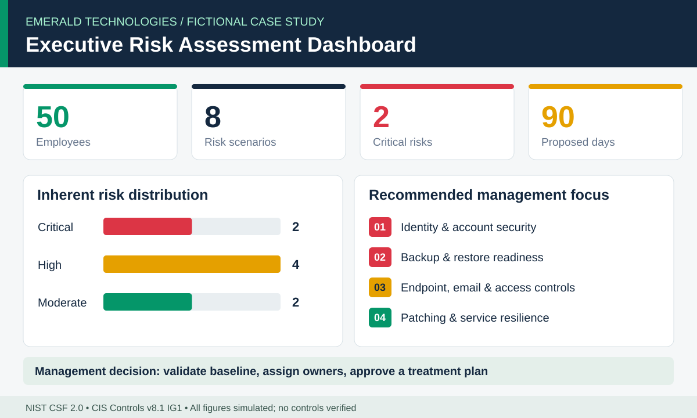
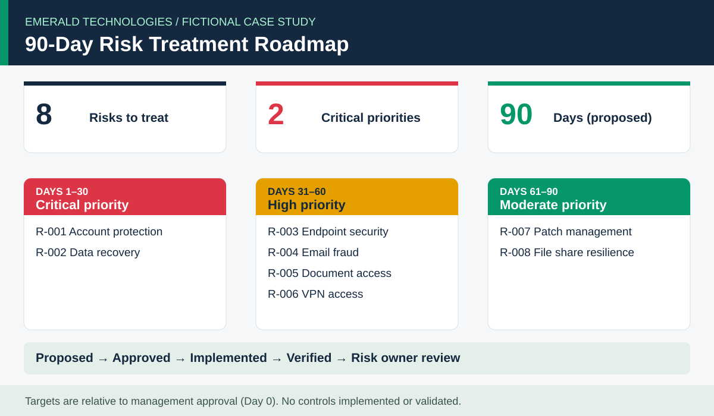

# Executive Summary — Information Security Risk Assessment

**Prepared for:** Executive Management, Emerald Technologies (fictional)  
**Assessment:** Enterprise Information Security Risk Assessment  
**Frameworks referenced:** NIST CSF 2.0 · CIS Controls v8.1 IG1  
**Assessment type:** Hypothetical qualitative case study  
**Status:** Assessment documentation completed; recommendations **not implemented or validated**

> **Executive disclaimer:** Emerald Technologies, its 50 employees, the asset register, and all risk scores are fictional. This document illustrates how to communicate a security risk assessment; it does not report findings from a real organization or claim verified control weaknesses.

## 1. Executive Decision Brief

**Management decision requested (hypothetical):** Authorize a 90-day risk-reduction planning effort, assign accountable business and technical owners, validate the asset and control baseline, and approve a proportionate implementation budget **after** scoping and cost estimates.

The scenario-based assessment covers **50 assumed employees**, **50 Windows workstations**, a Microsoft 365 environment, corporate VPN access, business file repositories, and backup/recovery services.

Eight hypothetical inherent risk scenarios were scored using a **project-defined 5 × 5 likelihood × impact model**.

| Risk rating | Count | Share | Management implication |
|---|---:|---:|---|
| **Critical** | **2** | **25%** | Prioritize identity security and recoverability |
| **High** | **4** | **50%** | Plan near-term improvements for endpoints, email, file access, and VPN |
| **Moderate** | **2** | **25%** | Address patch compliance and file-service resilience |
| **Low** | **0** | **0%** | No scenario scored Low in this illustrative set |

**Important:** These proportions describe **eight selected fictional scenarios**, not the organization's true risk prevalence, likelihood of an incident, or compliance level.

## 2. Business Exposure: What Matters Most

### Priority 1 — Account Takeover (R-001)

**Inherent score:** 20/25 — Critical.  
**Potential business impact:** Compromised employee or administrator accounts could expose confidential information, interrupt collaboration, and enable further unauthorized activity.  
**Proposed response:** Validate account inventory, MFA coverage, privileged access, and sign-in monitoring.  
**Decision required:** Confirm accountable ownership and authorize identity control review.

### Priority 2 — Unrecoverable Business Data (R-002)

**Inherent score:** 20/25 — Critical.  
**Potential business impact:** If ransomware or operational failure affects important files and restoration is unsuccessful, operations may remain disrupted for an extended period.  
**Proposed response:** Verify backup scope, protected copies, restore procedures, and recovery objectives through controlled testing.  
**Decision required:** Identify business-critical datasets and approve recovery targets.

### Priority 3 — Operational and Access Risks (R-003 to R-006)

**Inherent scores:** 12–16/25 — High.  
**Potential business impact:** Endpoint malware, fraudulent email requests, inappropriate file sharing, or unauthorized VPN access could disrupt services or compromise information.  
**Proposed response:** Strengthen endpoint baselines, phishing awareness and verification, access reviews, and remote-access policy enforcement.

### Priority 4 — Reliability Improvements (R-007 and R-008)

**Inherent scores:** 8–9/25 — Moderate.  
**Potential business impact:** Unpatched endpoints or internal file service outages could reduce service availability and increase recovery work.  
**Proposed response:** Establish monitored patch processes and test documented service recovery procedures.

## 3. Proposed 90-Day Plan

| Phase | Target | Risk focus | Expected decision or evidence |
|---|---|---|---|
| **Phase 1** | Days 1–30 | Critical: R-001, R-002 | Confirm identity and backup baseline; review MFA and conduct authorized restore testing |
| **Phase 2** | Days 31–60 | High: R-003 to R-006 | Review endpoint controls, email verification, sharing permissions, and VPN entitlements |
| **Phase 3** | Days 61–90 | Moderate: R-007, R-008 | Validate patch process and file-service recovery readiness |

**Day 0** is the future date of hypothetical management approval. These are **proposed targets**, not completed work or a guaranteed implementation schedule. Actual sequencing may overlap and depends on resources and verified conditions.

## 4. Governance and Framework Alignment

**NIST CSF 2.0** provides the outcome-oriented structure across **Govern, Identify, Protect, Detect, Respond, and Recover**.

**CIS Controls v8.1 IG1** provides candidate foundational safeguards for practical risk treatment. The [Control Mapping](../controls/control-mapping.md) connects the eight scenarios to proposed safeguards and validation evidence.

These references support the analysis; the case study does **not** claim NIST certification, CIS compliance, or use of an official crosswalk.

### Proposed accountability

| Role | Management responsibility |
|---|---|
| Executive sponsor — Operations Manager | Approve scope, resources, and treatment decisions |
| Business risk owners | Confirm impact, acceptable exposure, and residual risk decisions |
| IT / Infrastructure / Network / M365 leads | Implement authorized changes and produce evidence |
| IT Support / Security reviewers | Track exceptions, validate agreed criteria, and escalate gaps |

## 5. Recommended Management Actions

1. **Approve discovery and validation:** Confirm the fictional baseline assumptions before adopting any score or proposed action in a real setting.
2. **Assign risk owners:** Ensure each of the eight risks has an accountable business owner and a technical implementation lead.
3. **Prioritize critical exposure:** Review identity access and recovery capability first.
4. **Establish evidence-based milestones:** Require configuration records, access reviews, patch reports, and restore-test evidence as appropriate.
5. **Set business recovery targets:** Define recovery time and recovery point objectives for critical data and services.
6. **Request an implementation estimate:** Determine licensing, staffing, effort, and dependencies before approving expenditure.
7. **Review residual risk:** Reassess only after control implementation and effectiveness have been documented.

## 6. How Success Would Be Measured

| Proposed KPI | Measurement approach | Current baseline |
|---|---|---|
| MFA coverage for applicable accounts | Verified compliant accounts / in-scope accounts | Not measured |
| Endpoint patch compliance | Devices meeting approved patch SLA / in-scope devices | Not measured |
| Backup restore success | Successful approved restore exercises / attempted exercises | Not measured |
| Access review completion | Completed approved reviews / scheduled reviews | Not measured |
| Treatment action verification | Actions with accepted evidence / approved actions | 0 verified in this simulation |

**No actual KPI results are reported.** Management should define targets only after validating the environment and its operational constraints.

## 7. Limitations and Next Decision

This is a **fictional, desk-based portfolio assessment**. It contains no interviews, asset discovery, live configuration inspection, vulnerability testing, actual financial loss data, or operational validation. The 5 × 5 scoring method is defined for this case study, not mandated by NIST or CIS.

**Recommended next decision:** Approve a baseline-validation phase and authorize detailed planning of the critical-risk treatments. Do **not** mark risks closed or assign residual scores without evidence and accountable owner review.

## Supporting Documentation

- [Asset Inventory](../assets/asset-inventory.md)
- [Risk Register and Heatmap](../risk-register/risk-register.md)
- [NIST CSF / CIS IG1 Control Mapping](../controls/control-mapping.md)
- [Risk Treatment Plan](../treatment/risk-treatment-plan.md)
- [NIST Cybersecurity Framework](https://www.nist.gov/cyberframework)
- [CIS Critical Security Controls](https://www.cisecurity.org/controls)

## References & Official Documentation

- [NIST Cybersecurity Framework 2.0](https://www.nist.gov/cyberframework)
- [CIS Controls v8.1 Navigator](https://www.cisecurity.org/controls/cis-controls-navigator)
- [NIST SP 800-30 Rev. 1 — Guide for Conducting Risk Assessments](https://csrc.nist.gov/pubs/sp/800/30/r1/final)

*Sources support methodology and safeguards; fictional risk ratings are not verified findings.*

---

*Prepared as a fictional, educational portfolio deliverable. All figures and decisions are illustrative.*
