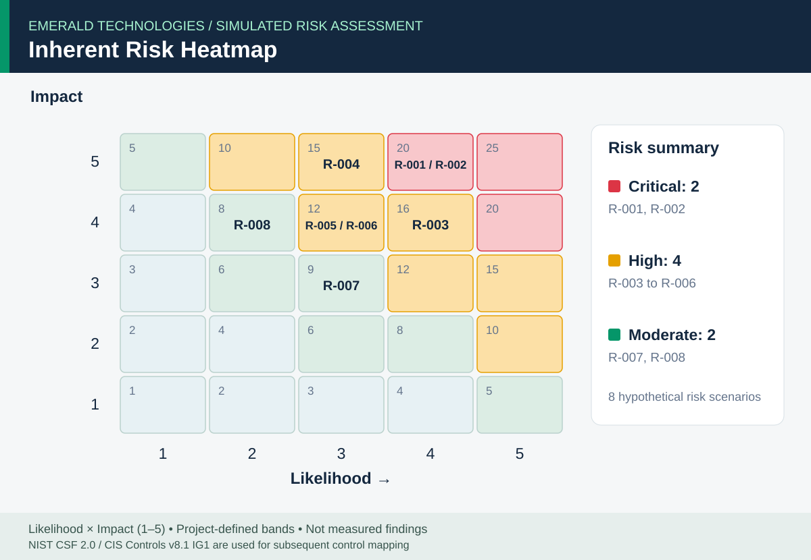
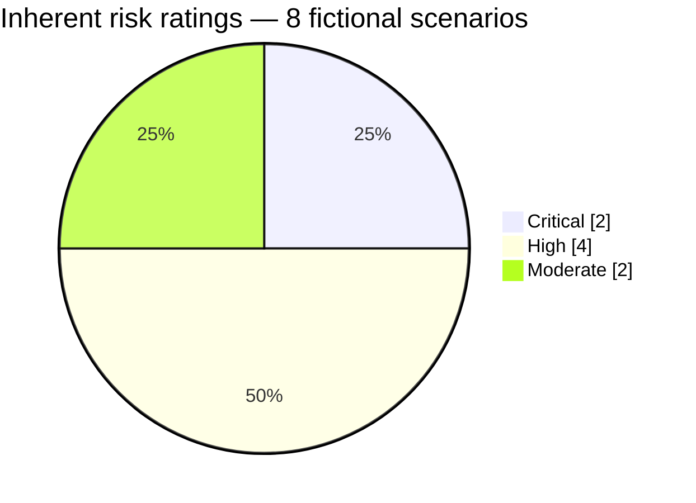

# Risk Register — Emerald Technologies

**Assessment:** Fictional enterprise information security risk assessment  
**Method:** Project-defined qualitative 5 × 5 likelihood × impact  
**Status:** Scenario analysis only — no technical testing or stakeholder validation

## At a Glance

| Total risks | Critical | High | Moderate | Low |
|---:|---:|---:|---:|---:|
| **8** | **2** | **4** | **2** | **0** |

> **Interpretation:** The scores below are illustrative **inherent risk estimates** based on explicitly hypothetical scenarios, before evaluating the effectiveness of any existing safeguards. They are not evidence of confirmed vulnerabilities, measured incident frequencies, or an actual organization's risk exposure.

## 1. Scoring Method

**Risk score = Likelihood (1–5) × Impact (1–5)**.

- Likelihood: 1 Rare · 2 Unlikely · 3 Possible · 4 Likely · 5 Almost certain.
- Impact: 1 Negligible · 2 Minor · 3 Moderate · 4 Major · 5 Severe.
- Low: **1–4**; Moderate: **5–9**; High: **10–16**; Critical: **17–25**.

This scale is **defined for this portfolio exercise**. NIST CSF 2.0 and CIS Controls v8.1 IG1 are used to structure security outcomes and treatment recommendations, **not** as the source of this scoring formula.

## 2. Risk Register

| Risk ID | Scenario | Affected assets | L | I | Score | Rating | Proposed business owner |
|---|---|---|---:|---:|---:|---|---|
| **R-001** | Account takeover via compromised credentials | AST-001, AST-003 | 4 | 5 | **20** | **Critical** | Operations Manager |
| **R-002** | Unrecoverable data following ransomware | AST-005, AST-007 | 4 | 5 | **20** | **Critical** | Operations Manager |
| **R-003** | Ransomware on employee endpoints | AST-002, AST-005 | 4 | 4 | **16** | **High** | Department Managers |
| **R-004** | Business email compromise and payment fraud | AST-003 | 3 | 5 | **15** | **High** | Operations Manager |
| **R-005** | Unauthorized access to cloud documents | AST-001, AST-004 | 3 | 4 | **12** | **High** | Department Managers |
| **R-006** | Unauthorized remote access via VPN | AST-001, AST-006 | 3 | 4 | **12** | **High** | Operations Manager |
| **R-007** | Unpatched workstation exploitation | AST-002 | 3 | 3 | **9** | **Moderate** | Department Managers |
| **R-008** | Internal file share availability outage | AST-005 | 2 | 4 | **8** | **Moderate** | Operations Manager |

**L = Likelihood; I = Impact.** Asset IDs refer to the [Asset Inventory](../assets/asset-inventory.md). Owner roles are assumed for the case study.

## 3. Scenario Rationale and Preliminary Treatment

| Risk ID | Why this score was selected (illustrative) | Initial treatment direction |
|---|---|---|
| R-001 | Phishing or credential reuse could permit unauthorized sign-in; MFA effectiveness is unverified. | Review MFA enrollment, privileged access and account recovery; monitor sign-ins. |
| R-002 | Malware could encrypt shared data while untested or insufficient backups delay restoration. | Verify backup coverage, protection, restore tests and recovery objectives. |
| R-003 | Malicious execution and uncertain patch/endpoint protection coverage could interrupt operations. | Strengthen endpoint configuration, protection, patching and recovery. |
| R-004 | A spoofed or hijacked mailbox could trigger fraudulent instructions or disclosure. | Improve email security awareness, verification procedures and account protection. |
| R-005 | Overly broad sharing or compromised accounts could expose confidential files. | Review sharing permissions, access governance and data classification. |
| R-006 | Weak remote access policy or compromised credentials could expose internal services. | Review VPN access policy, MFA, device posture and gateway logs. |
| R-007 | Unverified patch compliance may leave exploitable software vulnerabilities. | Establish monitored patch and vulnerability remediation procedures. |
| R-008 | Infrastructure failure or configuration error could interrupt access to shared files. | Review availability dependencies, recovery procedures and change controls. |

These are **proposed control improvements**, not assertions that safeguards are missing or ineffective.

## 4. Risk Heatmap

The visual above plots each risk by likelihood (horizontal axis) and impact (vertical axis). Where multiple risks share the same cell, both identifiers are shown. Cell background colors represent the **project-defined score bands**.

### Distribution

## 5. Assessment Limitations

- No interviews, vulnerability scans, control testing, incident records, or actual loss data were collected.
- The probability and severity values are judgment-based assumptions for a fictional business.
- No residual scores are assigned: control existence and effectiveness have not been assessed.
- Risk acceptance, tolerance, and treatment approval would require authorized business stakeholders.
- Priority may change after asset validation, control testing, and business impact analysis.

## 6. Next Step

Map each risk to relevant **NIST CSF 2.0** outcomes and **CIS Controls v8.1 IG1** safeguards, then produce an owner-assigned treatment plan with measurable validation criteria.

## References & Official Documentation

- [NIST SP 800-30 Rev. 1 — Guide for Conducting Risk Assessments](https://csrc.nist.gov/pubs/sp/800/30/r1/final)
- [NIST Cybersecurity Framework 2.0](https://www.nist.gov/cyberframework)

*These references support the methodology and technical procedures; they do not independently validate execution, findings, or control effectiveness.*

---

*Fictional portfolio scenario. No real enterprise has been assessed.*
