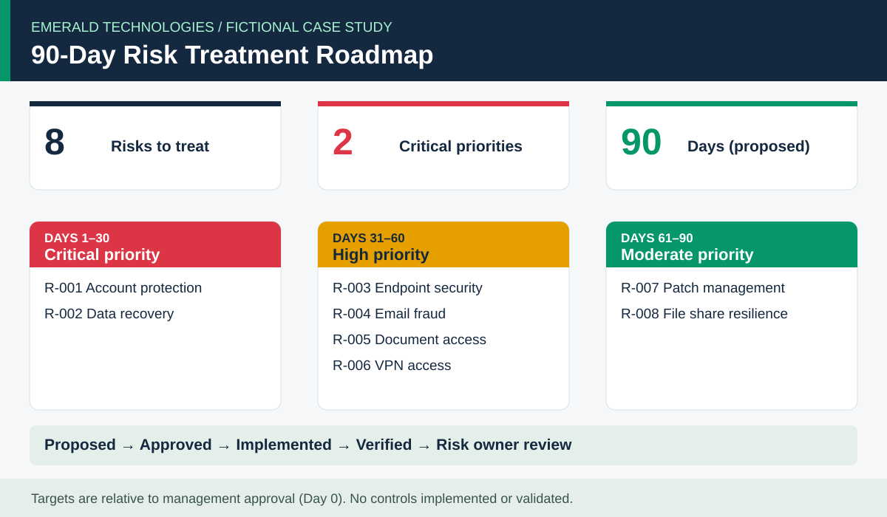
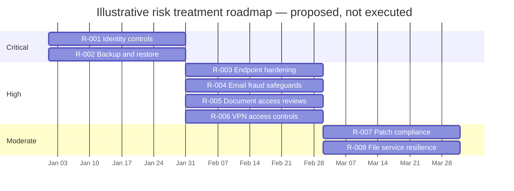

# Risk Treatment Plan — Emerald Technologies

**Organization:** Emerald Technologies (fictional)  
**Framework context:** NIST CSF 2.0 · CIS Controls v8.1 IG1  
**Source:** [Risk Register](../risk-register/risk-register.md) and [Security Control Mapping](../controls/control-mapping.md)  
**Plan status:** Proposed — no actions implemented or validated  
**Planning horizon:** 90 days after hypothetical management approval (Day 0)

> **Simulation disclaimer:** All scenarios, ownership assignments, schedules, resource assumptions, and control gaps are hypothetical. This plan is not a report of completed remediation or evidence of actual organizational compliance.

## 1. Executive Decision Summary

The assessment identified **8 hypothetical inherent risks**: **2 Critical, 4 High, and 2 Moderate**. The recommended strategy is to **reduce** all eight through proportionate control improvements, subject to management approval, operational feasibility, and verification of existing safeguards.

The **first 30 days** prioritize identity protection and recoverability (R-001 and R-002). Subsequent phases address endpoints, email fraud, file permissions, remote access, patching, and file-service availability.

**Risk treatment is not risk closure.** Every action remains open until authorized evidence demonstrates that the expected control outcome is achieved. Residual risk must then be reassessed and accepted or treated further by an accountable business owner.

## 2. Treatment Strategy and Priorities

| Risk | Inherent score | Rating | Treatment | Proposed owner | Target | Status |
|---|---:|---|---|---|---|---|
| **R-001** Account takeover | 20 | **Critical** | Reduce | IT Administrator | Day 30 | Proposed |
| **R-002** Unrecoverable data after ransomware | 20 | **Critical** | Reduce | Infrastructure Administrator | Day 30 | Proposed |
| **R-003** Endpoint ransomware | 16 | **High** | Reduce | IT Support Lead | Day 60 | Proposed |
| **R-004** Business email compromise | 15 | **High** | Reduce | M365 Administrator + HR | Day 60 | Proposed |
| **R-005** Unauthorized cloud document access | 12 | **High** | Reduce | M365 Administrator + Data Owners | Day 60 | Proposed |
| **R-006** Unauthorized VPN access | 12 | **High** | Reduce | Network Administrator | Day 60 | Proposed |
| **R-007** Unpatched workstation exploitation | 9 | **Moderate** | Reduce | IT Support Lead | Day 90 | Proposed |
| **R-008** Internal file share outage | 8 | **Moderate** | Reduce | Infrastructure Administrator | Day 90 | Proposed |

**Day 0** means the hypothetical date when management authorizes the plan and confirms the actual baseline. These are target dates, not achieved milestones. The owners are fictional job roles and must be assigned to real individuals in a production organization.

## 3. Proposed 90-Day Roadmap

*Dates in this visualization are **illustrative placeholders**, used only to show the sequence of a 90-day plan. Actual delivery dates must be established relative to the approved Day 0. Some workstreams can and should overlap where resources permit.*

## 4. Action Register and Acceptance Criteria

### Phase 1 — Days 1–30: Critical Risks

#### R-001 — Account Takeover

- **Assets:** AST-001, AST-003
- **Owner:** IT Administrator
- **Proposed actions:** Reconcile active accounts against authorized users; review externally exposed and privileged sign-in MFA enforcement; review the account recovery process; establish a documented exception and sign-in monitoring procedure.
- **NIST CSF 2.0:** PR.AA; DE.CM.
- **CIS IG1 candidates:** 5.1, 6.3, 6.5.
- **Required evidence:** Dated account inventory, approved MFA policy/configuration evidence, sampled sign-in control checks, exception register.
- **Acceptance criterion:** Every sampled in-scope account meets the approved authentication policy or has a documented, authorized exception; discrepancies have assigned remediation.
- **Status:** Proposed; not tested.

#### R-002 — Unrecoverable Data Following Ransomware

- **Assets:** AST-005, AST-007
- **Owner:** Infrastructure Administrator
- **Proposed actions:** Identify critical datasets; document recovery objectives with business owners; confirm backup coverage and protected copies; monitor backup jobs; execute a controlled restore test of representative data.
- **NIST CSF 2.0:** PR.DS; RC.RP.
- **CIS IG1 candidates:** 11.1, 11.2, 11.3, 11.4.
- **Required evidence:** Approved backup inventory and schedule, protected-copy configuration, recent job results, restore-test report, recovery time measurements.
- **Acceptance criterion:** An authorized restore test succeeds for an approved representative dataset and demonstrates performance against business-approved recovery objectives.
- **Status:** Proposed; not tested.

### Phase 2 — Days 31–60: High Risks

#### R-003 — Endpoint Ransomware

- **Assets:** AST-002, AST-005
- **Owner:** IT Support Lead
- **Proposed actions:** Define and apply an approved Windows security baseline; check endpoint protection deployment; identify unsupported or unpatched systems; document containment and escalation steps.
- **NIST CSF 2.0:** PR.PS; DE.CM.
- **CIS IG1 candidates:** 4.1, 7.3, 10.1.
- **Required evidence:** Baseline approval, configuration compliance report, endpoint protection coverage report, remediation tickets.
- **Acceptance criterion:** Sampled workstations meet the approved baseline and endpoint protection requirements; exceptions are tracked and authorized.
- **Status:** Proposed; not tested.

#### R-004 — Business Email Compromise

- **Assets:** AST-003
- **Owner:** M365 Administrator + HR
- **Proposed actions:** Review MFA coverage for externally exposed email access; deliver social-engineering awareness training; implement an independent verification procedure for sensitive payment or account changes.
- **NIST CSF 2.0:** PR.AT; PR.AA.
- **CIS IG1 candidates:** 14.2, 6.3.
- **Required evidence:** Training attendance, approved payment verification procedure, sampled MFA settings, reporting instructions.
- **Acceptance criterion:** Targeted staff complete the approved training and a sample of sensitive-change workflows demonstrates independent verification.
- **Status:** Proposed; not tested.

#### R-005 — Unauthorized Cloud Document Access

- **Assets:** AST-001, AST-004
- **Owner:** M365 Administrator + Data Owners
- **Proposed actions:** Inventory sensitive shared locations; review permissions and external sharing; document access granting and revocation; remove unauthorized access through approved change control.
- **NIST CSF 2.0:** PR.AA; PR.DS.
- **CIS IG1 candidates:** 3.3, 6.1, 6.2.
- **Required evidence:** Approved sharing policy, access review records, permission export, access change tickets.
- **Acceptance criterion:** Sampled sensitive repositories have documented owners, authorized access, and traceable access changes; exceptions are recorded.
- **Status:** Proposed; not tested.

#### R-006 — Unauthorized VPN Access

- **Assets:** AST-001, AST-006
- **Owner:** Network Administrator
- **Proposed actions:** Reconcile VPN entitlement with authorized personnel; review remote-access MFA enforcement; check account disablement and removal workflow; document gateway access logging.
- **NIST CSF 2.0:** PR.AA.
- **CIS IG1 candidates:** 6.4, 5.1.
- **Required evidence:** VPN policy, entitlement inventory, MFA enforcement evidence, sampled access review.
- **Acceptance criterion:** Sampled VPN users have authorized entitlement and required MFA; unauthorized or inactive access is revoked through approved procedures.
- **Status:** Proposed; not tested.

### Phase 3 — Days 61–90: Moderate Risks

#### R-007 — Unpatched Workstation Exploitation

- **Assets:** AST-002
- **Owner:** IT Support Lead
- **Proposed actions:** Establish OS and application patch deployment processes; measure compliance; document deadlines and exceptions; track remediation.
- **NIST CSF 2.0:** PR.PS.
- **CIS IG1 candidates:** 7.3, 7.4.
- **Required evidence:** Deployment policy, device update reports, exception register, remediation tickets.
- **Acceptance criterion:** Sampled endpoints meet business-approved patch timelines or have an authorized, time-bound exception.
- **Status:** Proposed; not tested.

#### R-008 — Internal File Share Outage

- **Assets:** AST-005
- **Owner:** Infrastructure Administrator
- **Proposed actions:** Document service dependencies and restoration runbook; verify backup/recovery dependencies; conduct a controlled restoration exercise.
- **NIST CSF 2.0:** PR.IR; RC.RP.
- **CIS IG1 candidates:** 11.1, 11.4.
- **Required evidence:** Approved recovery runbook, service dependency inventory, recovery exercise report, corrective-action log.
- **Acceptance criterion:** Recovery exercise demonstrates the agreed service restoration procedure and meets approved business targets or generates tracked remediation.
- **Status:** Proposed; not tested.

## 5. Governance, Reporting, and Dependencies

- **Executive sponsor (proposed):** Operations Manager — approves resources, priorities, exceptions, and risk decisions.
- **Risk owners:** Business owners identified in the risk register — accountable for business impact and risk acceptance.
- **Technical owners:** IT, infrastructure, network, M365, and HR roles — accountable for implementing and documenting assigned actions.
- **Review cadence:** Weekly technical progress review; management review at Days 30, 60, and 90.
- **Dependencies:** Asset inventory validation, approved policies, appropriate permissions, staff availability, recovery targets, and change-management approval.
- **Budget:** Not estimated; requires actual licensing, staffing, and infrastructure information.

### Suggested status vocabulary

**Proposed → Approved → In progress → Implemented → Verified → Closed**, with **Blocked** and **Exception approved** as additional tracked states.

A safeguard should be marked **Verified** only after its acceptance criteria are met with appropriate evidence. **Closed** additionally requires accountable risk-owner review of the remaining risk.

## 6. Evidence and Residual Risk

| Risk | Implementation evidence | Validation performed? | Residual score |
|---|---|---|---|
| R-001 | Not collected | No | Not assessed |
| R-002 | Not collected | No | Not assessed |
| R-003 | Not collected | No | Not assessed |
| R-004 | Not collected | No | Not assessed |
| R-005 | Not collected | No | Not assessed |
| R-006 | Not collected | No | Not assessed |
| R-007 | Not collected | No | Not assessed |
| R-008 | Not collected | No | Not assessed |

**Do not automatically subtract points from inherent risk scores when a safeguard is proposed.** Residual scoring requires evidence of control design, implementation, operating effectiveness, and the organization's approved risk assessment method.

**CIS scope note:** Restore testing remains a proposed verification activity, but CIS **11.5** is **IG2/IG3**, not IG1; CIS **11.1–11.4** are IG1. See the official Navigator below.

## 7. Exit Criteria for the 90-Day Plan

The proposed plan may be presented for closure review only when:

1. Each risk has a confirmed accountable owner and approved disposition.
2. Each action has an implementation record and supporting evidence.
3. Acceptance criteria have been independently reviewed as appropriate.
4. Unresolved findings and exceptions are documented and escalated.
5. Residual risks have been reassessed and formally accepted or scheduled for further treatment.

No exit criterion has been achieved in this fictional exercise.

## 8. Next Step

Create an [Executive Summary](../reports/executive-summary.md) that explains the simulated risk profile, top priorities, control strategy, and proposed 90-day plan in business language.

## References & Official Documentation

- [NIST Cybersecurity Framework 2.0](https://www.nist.gov/cyberframework)
- [CIS Controls v8.1 Navigator — implementation group applicability](https://www.cisecurity.org/controls/cis-controls-navigator)
- [NIST SP 800-30 Rev. 1 — risk assessment guidance](https://csrc.nist.gov/pubs/sp/800/30/r1/final)

*References support the proposed method; no remediation or testing has occurred.*

---

*Fictional portfolio case study; no remediation activities or validations have occurred.*
