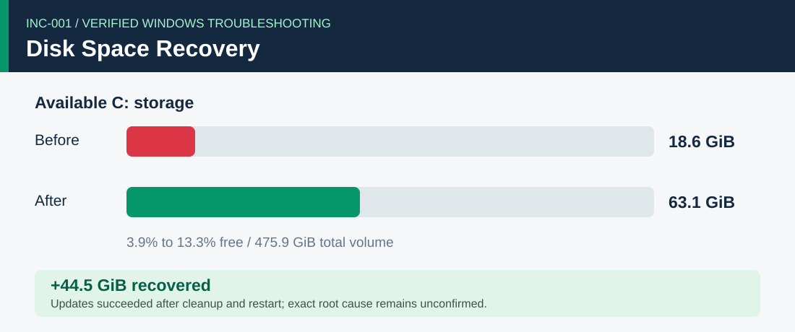
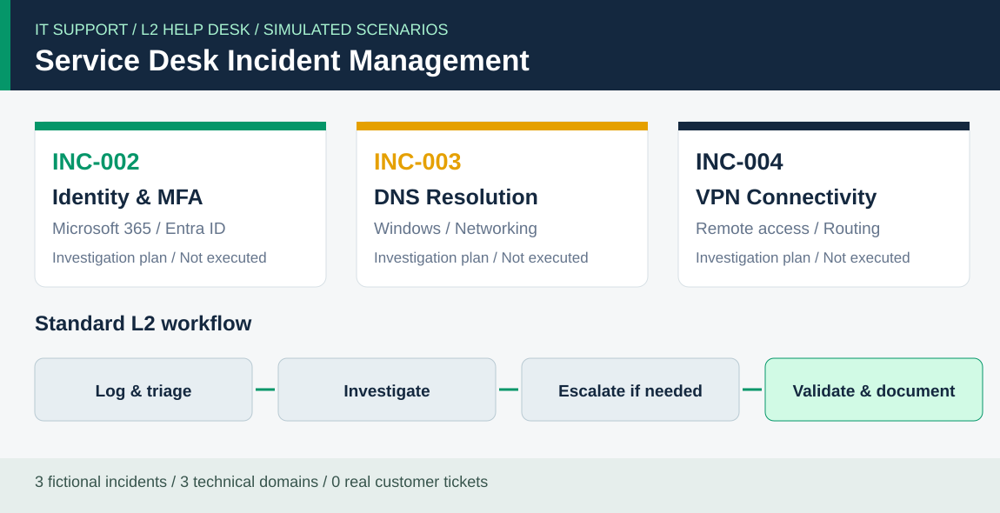
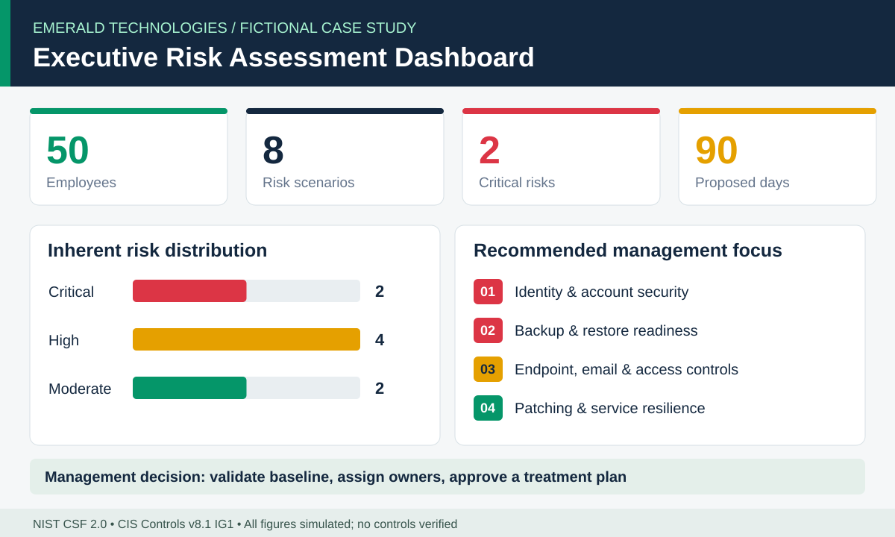
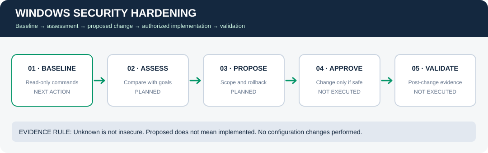

# IT Support, Systems Administration & Cybersecurity Portfolio

**Fefe Mora · IT Support L1/L2 · Systems Administration · Information Security · Cybersecurity**

   

**[Versión en español / Spanish version](https://github.com/fefemora/it-portfolio-es)**

I work across IT support, systems administration, and security. Much of my experience comes from troubleshooting systems, helping users get back to work, and keeping IT services running. This portfolio brings that work together with hands-on security investigations, technical documentation, and risk assessment.

The projects below show **what I checked, what I found, and what I could verify**. Some are based on real workstation investigations; others are clearly labeled simulations designed to explore technical decisions without claiming production experience.

## Explore by area

| Area | What you'll find |
|---|---|
| [ **IT Support & Troubleshooting**](IT-Support/README.md) | Real Windows troubleshooting and three L2 service desk scenarios |
| [ **Cybersecurity**](Cybersecurity/README.md) | Windows event analysis, endpoint security assessment, and controlled change validation |
| [ **Information Security / GRC**](Information-Security/Enterprise-Risk-Assessment/README.md) | Fictional enterprise risk assessment mapped to NIST CSF 2.0 and CIS Controls |
| [ **Systems Administration**](Systems-Administration/README.md) | Windows Server, Active Directory and identity management focus |
| [ **Networking**](Networking/README.md) | DNS, VPN, addressing and structured connectivity troubleshooting |
| [ **Cloud Networking & Security**](Cloud/README.md) | Azure, cloud access controls and hybrid networking development plans |
| [ **Technical Documentation**](Documentation/README.md) | Incident reports, evidence practices and reusable documentation |

## Featured work

###  INC-001 · Windows Update troubleshooting

  

Investigated recurring application updates and error `0x80073D02`. After cleanup and restart, free space increased from **18.6 GiB to 63.1 GiB**, and the updates completed successfully. The issue was resolved, although the exact root cause could not be isolated.

[Read the troubleshooting case](IT-Support/Windows-Troubleshooting-Lab/README.md)

###  L2 service desk · Identity, DNS and VPN

 

Three fictional incidents cover Microsoft 365 MFA recovery, DNS resolution, and VPN access to internal resources. Each case focuses on diagnostic reasoning, safe escalation, and the checks that would confirm a successful resolution. **The procedures were not executed against customer systems.**

[Browse the L2 incident cases](IT-Support/Service-Desk-Incident-Management/README.md)

###  Enterprise information security risk assessment

  

Built a qualitative risk assessment for a **fictional 50-person organization**. It includes an asset inventory, eight illustrative risk scenarios, proposed control mapping, and a 90-day treatment plan. The findings are hypothetical; no real organization or deployed safeguards were assessed.

[Explore the risk assessment](Information-Security/Enterprise-Risk-Assessment/README.md)

###  Windows Security Event Analysis

 

Examined Windows Security events, audit-policy settings, and a bounded correlation between **4624** and **4672**. The workstation's Security log held approximately **2.03 days** of events at the time of measurement, and process-creation auditing was disabled. **No malicious activity was confirmed.**

[Review the findings and evidence](Cybersecurity/Windows-Security-Event-Analysis/README.md)

###  Windows Security Hardening

  

Completed **28 technical checks and two assessment/closure steps** across Windows Firewall, Defender, auditing, PowerShell logging, BitLocker, and boot protection. A single approved change, **CHG-001**, raised the Security log limit from **20 MiB to 128 MiB**. The new limit was verified; seven-day retention and further hardening remain unverified or pending.

[Open the hardening assessment](Cybersecurity/Windows-Security-Hardening/README.md)

## Technical strengths

| Area | Evidence in this portfolio |
|---|---|
| **Windows & PowerShell** | Event logs, storage investigation, system checks and validation |
| **IT Support / Service Desk L2** | Incident triage, troubleshooting, escalation and user-facing documentation |
| **Microsoft 365 / Identity** | Simulated Entra ID and MFA recovery investigation |
| **Networking** | DNS and VPN diagnostic workflows |
| **Security Operations** | Windows logon/event analysis and endpoint security baselines |
| **Information Security / GRC** | Risk register, control mapping and treatment planning |
| **Communication** | Technical findings, executive summaries and clearly stated limitations |

## What comes next

I'm building on this foundation with **Active Directory and identity labs**, deeper **network diagnostics**, **SIEM monitoring**, and **cloud networking/security**. These are areas of development, not completed case studies.

## How evidence is handled

Every project distinguishes **real observations**, **simulated scenarios**, and **proposed changes**. I document limitations where a test, root cause, or security outcome has not been established. Public examples exclude confidential customer data and credentials.

---

**GitHub:** [github.com/fefemora](https://github.com/fefemora) · **Language:** [Español](https://github.com/fefemora/it-portfolio-es)
